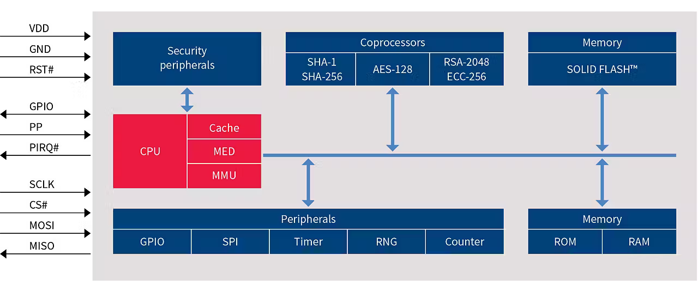
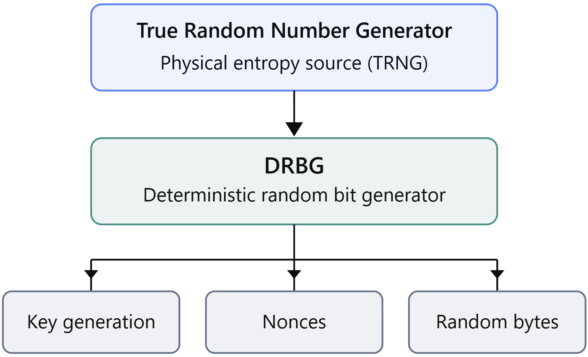
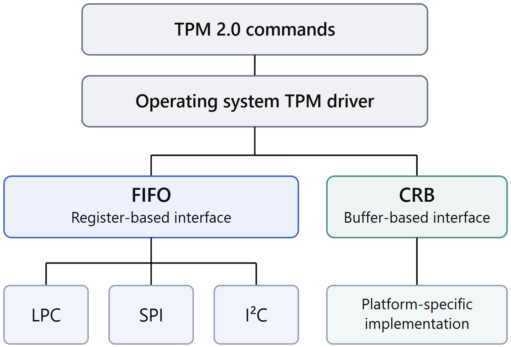
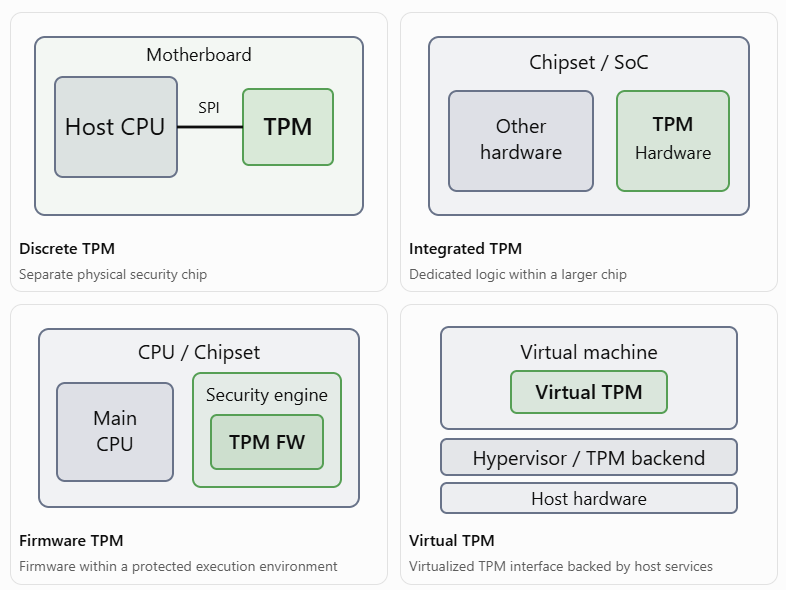

# Trusted Platform Module (TPM)

This document introduces the TPM — what it is, what hardware is inside it, how it operates, and where it is used.

## What Is a TPM?

A **Trusted Platform Module (TPM)** is a secure cryptoprocessor designed to perform security functions that ordinary software cannot safely do on its own. It is standardized by the [Trusted Computing Group (TCG)](https://www.trustedcomputinggroup.org/) and published as the international standard **ISO/IEC 11889**.

In plain terms, a TPM is a locked vault built into a computer. Software can ask the vault to generate keys, sign data, store secrets, and record what happened at startup — but it cannot reach inside and copy the vault's private keys.

A TPM is **not** a general-purpose processor. It runs no user applications, has no screen, and handles one command at a time. Its deliberate simplicity is a strength: a small, narrowly scoped component is easier to verify and harder to compromise than a full operating system.

A TPM can be a dedicated chip on a motherboard, protected firmware running inside a CPU's security engine, or a software instance presented to a virtual machine. These implementations follow the same standardized TPM command interface, but they differ in their security boundaries and physical attack resistance. The different implementation forms are compared in [TPM Implementations](#tpm-implementations).

## What a TPM Provides

A TPM offers a defined set of security capabilities. These are not independent features — they work together to protect a platform. The diagram below shows how these components are organized inside a real TPM 2.0 chip — the [Infineon SLM 9670](https://www.infineon.com/assets/row/public/documents/30/49/infineon-slm-9670-datasheet-en.pdf):

*Source: Infineon. The SLM 9670 is a discrete TPM 2.0 chip designed for industrial applications. Its PC-oriented counterpart is the SLB 9670. Both share the same core TPM architecture, making the SLM 9670 block diagram a practical reference for how TPM functionality is implemented in dedicated silicon.*

### 1. Coprocessors (cryptographic engines)

The top-center block labeled "Coprocessors" contains hardware accelerators for the TPM's supported cryptographic algorithms.

- **SHA-1 / SHA-256** — hash engines that compute cryptographic digests. SHA-256 is the modern standard; SHA-1 is retained for backward compatibility. (SHA-1 is a legacy algorithm and should not be used for new cryptographic applications.)

- **AES-128** — symmetric encryption engine. Used internally for wrapping keys, encrypting sealed data, and protecting objects stored outside the TPM.

- **RSA / ECC** — asymmetric engines for signing, decryption, and key generation. The SLM 9670 supports RSA-1024, RSA-2048, ECC NIST P-256, and ECC BN-256. RSA-2048 was the primary asymmetric algorithm in TPM 1.2. TPM 2.0 adds elliptic-curve cryptography, which provides comparable security strength using substantially smaller keys, reducing computational and storage requirements.

    > Per [NIST SP 800-57](https://nvlpubs.nist.gov/nistpubs/SpecialPublications/NIST.SP.800-57pt1r5.pdf), ECC P-256 provides approximately the same 128-bit classical security strength as RSA-3072. RSA-1024 provides only ~80 bits of classical security and is a legacy algorithm — it should not be used for new cryptographic applications. ECC BN-256 is a Barreto–Naehrig curve used for direct anonymous attestation via ECDAA.

### 2. Random number generator (RNG)

Visible in the "Peripherals" row of the diagram, the TPM contains an internal random-number generation subsystem that combines a hardware entropy source (true random number generator, or TRNG) with a **Deterministic Random Bit Generator (DRBG)** compliant with [NIST SP 800-90A](https://csrc.nist.gov/pubs/sp/800-90a/r1/final). This subsystem supplies cryptographically secure random data for key generation, nonces, and other cryptographic operations without depending on the host operating system's entropy sources.

### 3. Monotonic counters

The "Peripherals" row of the diagram includes a hardware **Counter** block. The TPM uses counters that can go up but never back down — like a car odometer. Each time you increment a counter, the TPM records the new value in non-volatile memory. Because the value can only increase, software can detect if someone tries to replay an old message or roll back to a previous state.

For example, a firmware update system can store the current update number in a TPM counter. If an attacker tries to reinstall older, vulnerable firmware, the system sees that the counter has already moved past that version and rejects it.

The SLM 9670 supports up to eight of these counters. The application must explicitly check the counter as part of its security protocol — the TPM does not automatically prevent rollback on its own.

> **Detail:** The diagram shows a physical counter peripheral inside the chip, while the TPM specification defines logical NV counters exposed through TPM commands. How the logical counters map to the physical hardware is implementation-specific.

### 4. Memory

On the right side of the diagram, the "Memory" blocks show the TPM's storage. The split between persistent and volatile memory is what gives the TPM its security model: the chip's identity and master secrets survive reboots (persistent storage), while boot measurements and working state start fresh each time (RAM).

#### Persistent memory (SOLID FLASH / ROM)

Two types of persistent storage survive power-offs:

- **SOLID FLASH™** is the TPM's main persistent storage. It holds the TPM's firmware, its master secrets (called **hierarchy seeds** in TPM 2.0, or the Endorsement Key and Storage Root Key in TPM 1.2), saved keys, authorization data, and a small area of general-purpose **non-volatile (NV) storage** that applications can use for counters, configuration, and other persistent data.

- **ROM** holds fixed code that cannot be changed after manufacturing — the chip's initialization routines, security checks, and self-test logic. This is the first code the TPM runs when it powers on, so it forms the foundation of trust inside the chip. The rest of the TPM's firmware lives in SOLID FLASH and can be updated (see [Management and Self-test](#3-management-and-self-test)).

#### Volatile memory (RAM)

If SOLID FLASH is the TPM's hard drive, **RAM** is its workspace — fast but temporary. Everything in RAM disappears when the chip loses power or is reset. It holds:

- **PCR banks** — registers that record boot measurements (see [Platform Configuration Registers](02-TPM-internals.md#platform-configuration-registers-pcrs)).
- **Loaded keys** — keys currently in use. The SLM 9670 can hold up to 3 keys in RAM at a time; the rest stay in NV memory until needed.
- **Active sessions** — ongoing authentication state between the host and the TPM.

On a cold boot (TPM Reset) or restart, all of this is wiped clean — that is by design, so each boot produces a fresh measurement record. TPM 2.0 also supports a **Resume** path (after suspend-to-RAM) that can restore designated PCR values and selected state from non-volatile memory. See [Power and Reset Management](#1-power-and-reset-management) for details.

#### Storage capacity and key management

The SLM 9670's storage at a glance:

| Resource | Capacity |
| --- | --- |
| Free NV memory | 6,962 bytes |
| Keys in NV memory (SOLID FLASH) | Up to 7 |
| Keys in volatile memory (RAM) | Up to 3 |
| NV counters | Up to 8 |

As the table shows, a TPM can hold only a handful of keys at any given time — far fewer than a typical system needs. This is by design: the TPM is a security device, not a key warehouse. In practice, most keys are stored *outside* the TPM as encrypted blobs and loaded into the TPM on demand for each operation. The TPM decrypts the key, performs the requested operation, and the key can then be flushed to free the slot for the next one. This load–use–flush cycle is how the TPM supports an unlimited number of keys despite its constrained storage. See [Key Storage](02-TPM-internals.md#key-storage) for a detailed explanation.

### 5. Host interface

A discrete TPM is a separate chip — it needs a physical bus to exchange commands and responses with the host CPU. You can see this in the SLM 9670 diagram: the **SPI** pins on the left side (SCLK, CS#, MOSI, MISO) are the chip's connection to the outside world.

| Interface | Typical speed | Where it is used |
| --- | --- | --- |
| **LPC** (Low Pin Count) | 33 MHz bus clock, but transfers one byte per transaction | Legacy PCs. The original bus for TPM 1.2 discrete chips. Still supported on some TPM 2.0 chips for backward compatibility. |
| **SPI** (Serial Peripheral Interface) | Up to 43 MHz on the SLM 9670, with multi-byte burst transfers | The modern standard for discrete TPM 2.0 on PCs and servers. Used by the SLM 9670 and most current discrete TPMs. |
| **I²C** | 400 kHz–1 MHz | Embedded and IoT systems where SPI is not available. Slower, but uses fewer pins. |

The industry moved from LPC to SPI for the following reasons:

- **Speed.** SPI supports multi-byte transfers, reducing transaction overhead compared with the single-byte transactions of the TPM LPC interface. Actual performance depends on bus frequency, wait states, driver implementation, and TPM command execution time. The difference is most noticeable during boot when many TPM commands are issued in rapid succession.

- **Simpler wiring.** SPI uses four signals (clock, chip-select, data-in, data-out). LPC uses more signal lines and shares the bus with other legacy devices.

- **Modern platform support.** Many newer chipsets and SoCs no longer include an LPC bus. SPI is widely available on modern platforms.

> **Note:** LPC, SPI, and I²C are physical transports used by discrete TPMs. Firmware TPMs communicate through platform-specific internal mechanisms. The operating system accesses TPM functionality through standardized host-facing interfaces — either **FIFO** (First-In-First-Out, used with LPC, SPI, and I²C) or **Command Response Buffer (CRB)** — depending on the implementation. From the OS perspective, the TPM command interface is the same regardless of the underlying transport.

## How a TPM Operates

The previous section walked through the physical blocks inside the chip. This section covers how the TPM *behaves* — how it handles power transitions, enforces access control, and maintains itself.

### 1. Power and reset management

Every time a computer powers on or wakes from sleep, the TPM needs to know: *should I start fresh, or pick up where I left off?* Getting this wrong would be a security problem — if stale boot measurements or old login sessions carried over into a new boot, an attacker could exploit them.

The SLM 9670's **VDD**, **GND**, and **RST#** pins (left side of the diagram) provide the power and hardware reset connections.

TPM 2.0 defines three startup paths. The platform firmware chooses which one to use based on how the system was shut down and how it is being started:

| When does this happen? | What the TPM does | Startup path |
| --- | --- | --- |
| **Cold boot** or unexpected power loss | Wipes all volatile state — PCRs, loaded keys, sessions — and starts clean. | **TPM Reset** |
| **Warm reboot** after an orderly shutdown | Also wipes volatile state, but the TPM knows the previous shutdown was clean. | **TPM Restart** |
| **Wake from sleep** (e.g., laptop lid open) | Restores previously saved PCR values and session state, avoiding a full re-measurement of the boot chain. | **TPM Resume** |

In short: a cold boot or reboot always gives you a fresh measurement record, while waking from sleep can restore the previous state — the platform firmware decides which path to take.

> **Detail:** These three paths are controlled by the TPM's shutdown and startup commands. The specific command parameters that select each path are covered in [Command Interface](#1-command-interface) and [TPM Internals](02-TPM-internals.md).

### 2. Authorization and policy engine

The **CPU** block at the center of the diagram runs the TPM's internal firmware and enforces access control. The firmware verifies the authorization requirements associated with each command, hierarchy, object, and NV index.

In TPM 1.2, authorization is based on HMAC secrets, PCR state, locality, or physical presence. TPM 2.0 adds a flexible **policy engine** that supports password-based authorization, HMAC sessions, and policy sessions that can combine conditions — for example, requiring *both* a correct PIN *and* a PCR match, or restricting a key to a specific command.

The TPM can also enforce time-based policies — for example, allowing a key to be used only within a certain elapsed-time window. The **Timer** peripheral in the diagram supports these timing functions.

### 3. Management and self-test

The TPM's internal firmware includes a **management** subsystem responsible for administrative functions that are not part of normal cryptographic operations:

- **Self-test.** The TPM performs required internal self-tests during initialization and can run additional tests on demand. If a required self-test fails, the TPM enters a failure mode, restricting normal operations while still allowing limited diagnostic queries.

- **Firmware update (field upgrade).** Some TPMs support updating their internal firmware after deployment. The management subsystem validates the update before applying it — on the SLM 9670, firmware updates are verified using RSA-2048 signatures with SHA-256. This is how TPM firmware vulnerabilities are patched without replacing the chip. Not all TPMs support field upgrades — some use write-once ROM and cannot be updated.

- **Internal clock.** The TPM maintains its own timing subsystem, driven by the **Timer** peripheral visible in the SLM 9670 diagram. TPM 2.0 distinguishes several timing values:

  | Field | Description |
  | --- | --- |
  | `Time` | Elapsed powered time since the timing circuit was last initialized |
  | `Clock` | Cumulative timing value maintained across ordinary power cycles |
  | `resetCount` | Count of TPM Reset events since the last TPM clear operation |
  | `restartCount` | Count of TPM Restart and Resume events since the last TPM Reset |
  | `safe` | Indicates whether the reported clock value can be trusted not to repeat earlier values |

  The TPM is **not** a real-time clock (RTC) — it tracks elapsed time, not wall-clock time or time of day. Unexpected power loss can affect clock continuity because the latest clock value may not have been committed to NV storage, and a TPM clear operation can reset the clock. These timing values support time-based authorization policies (for example, restricting key use based on elapsed time, clock values, or reset and restart counters).

## Communicating with a TPM

### 1. Command interface

The TPM specification defines a fixed set of **commands** — the operations that software can ask the TPM to perform. Each command has a formal name, a numeric command code, and a defined request/response structure. Software sends a command, the TPM processes it, and returns a response. The TPM handles one command at a time.

TPM 2.0 commands are prefixed with `TPM2_`. TPM 1.2 commands use the `TPM_` prefix. These names come from the [TPM 2.0 Library Specification, Part 3: Commands](https://trustedcomputinggroup.org/resource/tpm-library-specification/) (or the TPM 1.2 Main Specification for older commands). Some examples:

| Command              | What it does |
| -------------------- | ------------ |
| `TPM2_CreatePrimary` | Create a primary object from a hierarchy seed and an input template |
| `TPM2_Create`        | Create a child object (such as a key or sealed-data object) under a parent |
| `TPM2_Load`          | Load an object's public and protected private portions into the TPM |
| `TPM2_Sign`          | Sign a digest using a loaded signing key |
| `TPM2_PCR_Extend`    | Extend one or more measurement digests into a PCR |
| `TPM2_Quote`         | Generate a signed attestation containing a digest of selected PCR values |
| `TPM2_GetRandom`     | Obtain random bytes from the TPM |
| `TPM2_GetCapability` | Query TPM capabilities and properties |

Throughout these documents, `TPM2_` names refer to these specification-level commands. They are vendor-neutral — the same command name applies whether the TPM is accessed from Linux, Windows, or any other platform.

On Linux, the `tpm2-tools` package provides command-line utilities that map to these specification commands. For example, the CLI command `tpm2_createprimary` sends a `TPM2_CreatePrimary` command to the TPM through the software stack (see [TPM 2.0 Software Stack](03-TPM-software-stack.md)).

### 2. Cryptographic algorithms

The [coprocessors](#1-coprocessors-cryptographic-engines) described above are dedicated hardware engines visible in the SLM 9670 block diagram. But a TPM supports far more algorithms than it has labeled hardware blocks. You can query a TPM for its full list of supported algorithms, and they can be understood in the following categories.

> **Note:** The algorithm list a TPM reports identifies logical capabilities, not physical hardware components. A software TPM can report the same algorithm identifiers even though it contains no dedicated coprocessors. The categories below are a pedagogical aid for understanding how algorithms relate to each other — they are not a classification defined by the TCG specification, and the exact hardware/firmware boundary for any given algorithm is implementation-specific.

**Foundational algorithms** have dedicated hardware acceleration on the SLM 9670 (as shown in the block diagram), though other TPM implementations may implement them in software:

| Category | Algorithm identifiers |
| --- | --- |
| Hash | `sha1`, `sha256` |
| Symmetric | `aes` |
| Asymmetric | `rsa`, `ecc` |

**Modes, schemes, and constructions** are higher-level operations built on top of the foundational algorithms. The TPM firmware orchestrates the underlying algorithm to implement these:

| Built on | Derived algorithms |
| --- | --- |
| Hash | `hmac` (keyed-hash message authentication), `mgf1` (mask generation for OAEP/PSS), `keyedhash` (HMAC/XOR key object type) |
| Symmetric (AES) | `ctr`, `cbc`, `cfb`, `ofb`, `ecb` (block-cipher modes), `symcipher` (symmetric cipher object type) |
| RSA | `rsassa`, `rsapss` (signing schemes), `rsaes`, `oaep` (encryption/padding schemes) |
| ECC | `ecdsa`, `ecdaa` (signing), `ecdh` (key agreement), `ecschnorr` (Schnorr signatures) |

For example, HMAC wraps a hash algorithm in the HMAC construction (inner and outer hash passes). AES-CBC applies the AES algorithm repeatedly with mode-specific chaining logic. Whether these constructions use the hardware hash or AES engine depends on the implementation.

**Key derivation and obfuscation** algorithms derive new keying material from existing secrets:

| Algorithm | Purpose |
| --- | --- |
| `kdf1_sp800_56a` | Key derivation for key-agreement schemes (NIST SP 800-56A) |
| `kdf1_sp800_108` | Counter-mode key derivation (NIST SP 800-108) — used to derive primary keys from hierarchy seeds |
| `xor` | XOR-based parameter obfuscation in sessions |

A KDF is essentially repeated HMAC or hash operations with prescribed formatting. For asymmetric primary keys, the KDF output serves as input to algorithm-specific key-generation operations — it is not simply treated as the finished key.

The exact division of work between hardware and firmware is implementation-specific — it varies across TPM manufacturers, chip generations, and even firmware versions. What the TPM specification guarantees is the algorithm interface and its cryptographic properties, not how each algorithm is implemented internally. The [TCG Algorithm Registry](https://trustedcomputinggroup.org/resource/tcg-algorithm-registry/) defines the classifications and semantics of all TPM algorithm identifiers.

## TPM Versions: 1.2 vs. 2.0

TPM has gone through two major versions. **TPM 2.0 is the current standard** for all new devices. TPM 1.2 is considered obsolete for new deployments.

| Feature | TPM 1.2 | TPM 2.0 |
| --- | --- | --- |
| **Standard** | ISO/IEC 11889:2009 (4-part spec) | ISO/IEC 11889:2015 (4-part library spec) |
| **Hash algorithms** | SHA-1 required | SHA-256 required; algorithm-agile design supports SHA-384, SHA-512, and others depending on platform profile |
| **Asymmetric algorithms** | RSA only (RSA-2048 required) | RSA and ECC (NIST P-256 required); algorithm-agile design supports additional algorithms |
| **Symmetric algorithms** | AES optional | AES-128 required; AES-256 and others depending on platform profile |
| **Key hierarchies** | One hierarchy (single Storage Root Key) | Three persistent hierarchies (Platform, Storage, Endorsement) plus a Null hierarchy for ephemeral keys |
| **Root keys** | One SRK (RSA-2048) | Multiple primary keys per hierarchy, supporting different algorithms |
| **Authorization** | HMAC, PCR, locality, physical presence | Password, HMAC, and flexible policy-based authorization (counters, time limits, NV values, digital signatures, compound AND/OR policies) |
| **NV storage types** | General-purpose NV storage and monotonic counters | Typed NV indices: ordinary data, counters, bitmaps, extend indices, PIN pass/fail |
| **Platform scope** | Primarily PC | Library designed for PCs, mobile, automotive, IoT, and embedded |
| **Post-quantum** | Not supported | ML-KEM and ML-DSA introduced in Library Version 185 (March 2026) |

> **Note:** The TPM 2.0 Library Specification defines the available functionality, while **Platform TPM Profile** (PTP) specifications define which algorithms and commands are mandatory for a particular class of device. For example, the PC Client PTP Version 1.07 (March 2026) requires SHA-384, SHA-512, AES-256, RSA-3072, ML-KEM, and ML-DSA, while making SHA-1 no longer allowed. Older TPM 2.0 chips conform to earlier platform profiles and may not support all current requirements.

> **Note:** TPM 2.0 is **not** backward compatible with TPM 1.2. The command set, key structures, and authorization model are entirely different. Software written for TPM 1.2 must be rewritten or replaced to work with TPM 2.0.

### Why TPM 2.0 replaced 1.2

- **Stronger cryptography.** SHA-1 is considered weak for many security applications. NIST required federal agencies to move to SHA-256 by 2014, and major vendors (Microsoft, Google) dropped SHA-1-based signing by 2017. TPM 2.0 mandates SHA-256.
- **Elliptic-curve support.** ECC P-256 provides comparable security strength to much larger RSA keys (a 256-bit ECC key ≈ a 3072-bit RSA key), reducing key sizes and computational requirements on constrained hardware.
- **Flexible authorization.** TPM 2.0's policy engine supports complex rules — for example, requiring *both* a PCR match *and* a PIN, or allowing access only during certain time windows.
- **Multiple hierarchies.** Separating Platform, Storage, and Endorsement hierarchies allows different administrators (OEM, OS, privacy) to control different parts of the TPM independently.
- **Broader platform support.** The library specification was designed from the start to support embedded, mobile, automotive, and IoT platforms — not just PCs.

### Timeline

| Year | Milestone |
| ---- | --- |
| 1999 | Trusted Computing Platform Alliance (TCPA) formed by Compaq, HP, IBM, Intel, and Microsoft. |
| 2003 | Trusted Computing Group (TCG) succeeds TCPA; publishes TPM as an open specification. |
| 2004 | TCG announces TPM 1.2. PC makers begin shipping TPM-equipped desktops and laptops. |
| 2009 | TPM 1.2 standardized as ISO/IEC 11889:2009. |
| 2014 | TCG publishes the TPM 2.0 Library Specification. |
| 2015 | TPM 2.0 standardized as ISO/IEC 11889:2015. |
| 2021 | Windows 11 launches with TPM 2.0 as an official hardware requirement. |
| 2026 | TCG releases TPM 2.0 Library Specification Version 185, introducing post-quantum cryptographic algorithm support (ML-KEM per FIPS 203 and ML-DSA per FIPS 204). PC Client Platform TPM Profile Version 1.07 follows, requiring mandatory PQC support and disallowing SHA-1. |

## TPM Implementations

The TPM specification defines **behavior and interfaces**, not physical packaging. A TPM can be implemented in several ways:

| Implementation | Description | Examples |
| --- | --- | --- |
| **Discrete TPM (dTPM)** | A separate physical chip on the motherboard, connected to the host via a bus interface (see [Host Interface](#5-host-interface)). Provides its own hardware security boundary. Often certified (Common Criteria, sometimes FIPS 140). | Infineon SLM 9670, Nuvoton NPCT750 |
| **Integrated TPM** | TPM logic built into a larger hardware component (such as a chipset) but still implemented as dedicated TPM hardware. | Platform-specific integrated designs |
| **Firmware TPM (fTPM)** | TPM functionality provided by protected firmware running inside a hardware-isolated execution environment on the CPU or chipset — such as Intel's Converged Security and Management Engine (CSME) or AMD's Platform Security Processor (PSP). No external bus to tap. Security depends on the isolation of the execution environment and its firmware. | Intel PTT (runs in CSME), AMD fTPM (runs in PSP) |
| **Software TPM (sTPM)** | TPM functionality implemented entirely in software on a general-purpose processor, without dedicated hardware isolation. Useful for development, testing, and simulation. See [TPM 2.0 Lab Setup](04-TPM-lab-setup.md) for a hands-on walkthrough using `swtpm`. | TPM software simulator, `swtpm` |
| **Virtual TPM (vTPM)** | A TPM-compatible interface presented to a virtual machine guest. A vTPM may be backed by a software TPM, hardware-protected security services, or a trusted execution environment. Security guarantees depend on the underlying implementation and host platform. | QEMU with `swtpm`, Hyper-V vTPM, AWS NitroTPM |

### Which is more secure?

No single implementation is universally better:

- A **discrete TPM** has its own chip with dedicated security hardware, but its host bus is a potential physical attack surface (see [Host Interface](#5-host-interface)).
- A **firmware TPM** eliminates the external bus, but its security depends entirely on the isolation of the host platform's security engine (Intel CSME, AMD PSP), which has had security vulnerabilities in the past.
- A **virtual TPM** based on software emulation relies on the hypervisor and host platform for isolation. Hardware-backed vTPM implementations can provide stronger guarantees.

The right choice depends on the platform, threat model, certification requirements, and firmware update practices.

## Which Platforms Use TPM?

TPM is used across a wide range of platforms — from desktops and servers to embedded and IoT devices:

| Platform | TPM usage |
| --- | --- |
| **Windows PCs (Intel)** | TPM 2.0, either as a discrete chip or Intel Platform Trust Technology (PTT) — a firmware TPM running inside Intel's CSME. The OS sees both as a standard TPM. |
| **Windows PCs (AMD)** | TPM 2.0, either as a discrete chip or AMD fTPM running inside the AMD Platform Security Processor (PSP). On pre-2026 silicon, some devices used Microsoft Pluton as the TPM; beginning with 2026 silicon, Pluton [no longer serves as the TPM](https://learn.microsoft.com/en-us/windows/security/hardware-security/pluton/pluton-as-tpm) on AMD platforms. |
| **Windows PCs (Qualcomm)** | TPM 2.0 via firmware TPM or discrete TPM. On pre-2026 Snapdragon silicon, Microsoft Pluton could serve as the TPM; beginning with 2026 silicon, TPM functionality is delivered through the vendor's fTPM or a discrete TPM. |
| **Windows 11** | Officially requires TPM 2.0 and UEFI Secure Boot capability among its minimum system requirements. |
| **Linux** | Full TPM 2.0 support through kernel drivers (`tpm_crb`, `tpm_tis`) and the `tpm2-tss` / `tpm2-tools` user-space stack. Used for LUKS disk encryption (`systemd-cryptenroll`), measured boot, SSH keys, and remote attestation. |
| **ChromeOS / Chromebooks** | Verified boot with a TPM or Google security chip for key storage, rollback protection, and hardware-backed certificates. ChromeOS Flex supports certain TPM 1.2 and TPM 2.0 chipsets. |
| **Servers and data centers** | Discrete TPMs are common for measured boot, firmware attestation, and machine identity in fleet management. Cloud providers add their own chips (e.g., Google Titan). |
| **Windows IoT** | Windows IoT Core supports TPM 2.0 (discrete and firmware implementations). |
| **Embedded and IoT devices** | TPM 2.0 chips (e.g., Infineon OPTIGA TPM) protect device integrity, enable remote attestation, and secure firmware updates. Lightweight alternatives like TCG DICE exist for more constrained devices. |

## How TPM Is Used in Practice

### Full-disk encryption

Full-disk encryption encrypts the entire contents of a drive so that stolen hardware cannot be read. The TPM protects a disk-unlock secret using TPM-bound cryptographic keys and, optionally, a PCR-based authorization policy. The sealed secret is stored on disk, outside the TPM. During boot, the TPM unseals the secret only when its authorization requirements are satisfied.

- **Windows BitLocker:** Uses the TPM to seal the Volume Master Key (VMK). The sealed VMK is stored encrypted on disk, and the TPM will only unseal it when boot measurements (PCR values) match the expected state. An optional startup PIN adds a second factor. If the boot process is tampered with, the TPM refuses to unseal the key and the drive stays locked.
- **Linux LUKS2:** Tools like `systemd-cryptenroll` can bind a LUKS disk-unlock secret to a TPM 2.0 token and a PCR policy, achieving the same hardware-tied protection on Linux.

### Secure sign-in

Instead of relying on a password that could be stolen or reused, the TPM can hold a device-bound authentication key that never leaves the hardware.

- **Windows Hello:** Creates a device-bound asymmetric credential and protects it with the TPM when available. A PIN or biometric (fingerprint, face) authorizes its use. The PIN is device-specific — it is tied to the TPM on that device and cannot independently authenticate the user from another device.

### Measured boot and device health

During startup, each stage of the boot process records a cryptographic fingerprint of the next stage into the TPM's Platform Configuration Registers (PCRs). This creates a tamper-evident record of everything that ran — if any component changes, the recorded values change too.

Enterprise systems use this record to verify device health before granting network access or issuing certificates. Measured boot provides evidence of what booted — it does not by itself prevent untrusted software from executing.

> For the full technical details see [Integrity Measurement](02-TPM-internals.md#integrity-measurement).

### Code and document signing

Applications can generate signing keys that live inside the TPM. When a document or piece of code is signed, the TPM performs the signing operation internally — the private key is never exposed to the operating system or any application. On Windows this works through the Platform Crypto Provider; on Linux through `tpm2-tools`.

### Dictionary-attack protection

For dictionary-attack-protected objects and authorization entities, the TPM tracks failed authorization attempts. After a configured number of wrong guesses, it restricts further protected authorization attempts until recovery conditions are met. This hardware-enforced rate limiting prevents high-speed guessing attacks that software alone cannot stop. (TPM 2.0 objects with the `noDA` attribute are exempt from this protection.)

## TPM Limitations

A TPM strengthens specific security properties. It is not a complete security solution.

| Limitation | Explanation |
| --- | --- |
| **Not a full disk-encryption engine.** | The TPM is slow and handles one command at a time. It unseals the encryption key; the main CPU (using AES instructions) or a storage controller encrypts the actual data. |
| **Does not stop post-login malware.** | If you approve a malicious program after logging in, the TPM cannot prevent it from requesting authorized operations or reading data that has already been decrypted. |
| **Physical attacks are possible.** | A consumer TPM is primarily designed against software attacks and stolen-disk scenarios. A well-funded attacker with physical access may exploit the host bus (see [Host Interface](#5-host-interface)) or firmware vulnerabilities. Certified discrete TPMs include tamper-detection hardware (the "Security peripherals" block in the SLM 9670 diagram); HSMs invest even more in physical resistance. |
| **Firmware bugs affect the root of trust.** | A vulnerability in TPM firmware, Intel CSME, or AMD PSP can undermine the guarantees built on them. Firmware updates are the primary mitigation. |
| **Updates change measurements.** | A firmware or OS update can change PCR values and trigger disk-encryption recovery. This is the system working correctly — keep recovery keys stored safely. |
| **Virtual TPMs inherit host trust.** | A software-emulated vTPM is only as trustworthy as the hypervisor and host platform. Hardware-backed vTPM implementations (such as AWS NitroTPM) can provide stronger isolation, but their guarantees still depend on the underlying security architecture. |

## What Happens Without a TPM?

A device without a TPM can still implement encryption, authentication, and other security features. However, it lacks the standardized TPM-backed mechanisms for protected key storage, platform measurements, sealing, and attestation. Equivalent protections may require alternative hardware security mechanisms (such as a Secure Enclave, HSM, or Secure Element) or rely more heavily on software.

| Problem without a TPM | How a TPM solves it |
| --- | --- |
| **Keys stored as files can be copied.** An attacker who copies the storage or runs privileged malware can read a software-only encryption key. | The TPM generates and holds keys internally. The host software can ask the TPM to sign or decrypt, but the private key never leaves the module. |
| **Nothing records what booted.** A rootkit that replaces the bootloader starts before the OS and before any security software. | The TPM's Platform Configuration Registers (PCRs) accumulate cryptographic measurements of each boot stage. Changes to the boot path change the PCR values. |
| **Disk encryption is not tied to the device.** A copied disk or storage image with the same password unlocks on any hardware. | The TPM can seal the encryption key to a specific set of boot measurements. The key is released only on the original device, in the expected boot state. |
| **The device cannot prove its identity.** A software-managed private key can be extracted and used on another machine. | A TPM 2.0 maintains a protected Endorsement Primary Seed (EPS) from which hardware-bound Endorsement Keys can be generated. These keys, and the attestation mechanisms built on them, are rooted in the TPM's protected security boundary. |
| **Weak passwords can be guessed offline at high speed.** | The TPM can enforce a dictionary-attack lockout, limiting how many wrong guesses are allowed before access is temporarily blocked. |

Without a TPM, you lose the guarantees that depend on a hardware anchor: device-bound keys, protected boot measurements, and hardware-backed identity.

## TPM vs. Related Technologies

TPM is one of several hardware security technologies. They solve overlapping but distinct problems:

| Technology | What it is | How it relates to TPM |
| --- | --- | --- |
| **Secure Enclave** (Apple) | Isolated security subsystem inside Apple silicon | Similar goals (key protection, attestation) but uses Apple's proprietary interface, not the TCG TPM command set. Modern Apple devices use the Secure Enclave instead of a TPM. (Some early Intel-based Macs included discrete TPM chips, but current Apple silicon Macs do not.) |
| **Microsoft Pluton** | Security processor in some newer CPUs | On pre-2026 AMD and Qualcomm silicon, Pluton could serve as the system TPM. Beginning with 2026 silicon, Pluton no longer provides TPM functionality — it continues as a security processor for other platform security services. |
| **HSM** (Hardware Security Module) | Dedicated key-management product for organizations | An HSM manages many keys for an organization; a TPM protects one platform. Different scope, complementary roles. |
| **TEE** (Trusted Execution Environment) | Isolated execution mode (e.g., ARM TrustZone, Intel SGX) | A TEE can host a firmware TPM, but a TEE is an execution environment, not a trust anchor by itself. Android phones use ARM TrustZone and optionally a Secure Element; Android's StrongBox Keystore provides hardware-backed key isolation on devices with a dedicated secure element. |
| **Secure Element** | Small tamper-resistant chip (e.g., SIM card, Google Titan M, payment chip) | Stores a few keys for a narrow purpose. A TPM has broader platform responsibilities (boot measurement, attestation). |

## References

**Standards and specifications**

- Trusted Computing Group — [TPM 2.0 Library Specification](https://www.trustedcomputinggroup.org/resources/documents/tpm-library-specification) (Version 185, March 2026)
- Trusted Computing Group — [TPM 1.2 Main Specification](https://www.trustedcomputinggroup.org/resources/documents/tpm-main-specification)
- ISO/IEC 11889:2015 — [Information technology — Trusted Platform Module Library](https://www.iso.org/standard/66510.html) (Parts 1–4)
- ISO/IEC 11889:2009 — TPM 1.2 (superseded by the 2015 edition)
- TCG — [PC Client Platform TPM Profile Specification](https://www.trustedcomputinggroup.org/work-groups/pc-client)

**Vendor documentation**

- Microsoft — [TPM overview](https://learn.microsoft.com/en-us/windows/security/hardware-security/tpm/trusted-platform-module-overview), [TPM recommendations](https://learn.microsoft.com/en-us/windows/security/hardware-security/tpm/tpm-recommendations), and [How Windows uses the TPM](https://learn.microsoft.com/en-us/windows/security/hardware-security/tpm/how-windows-uses-the-tpm)
- Dell — [TPM 1.2 vs 2.0 Key Differences and Features](https://www.dell.com/support/kbdoc/en-us/000131631/tpm-1-2-vs-2-0-features)
- Infineon — [OPTIGA TPM](https://www.infineon.com/cms/en/product/security-smart-card-solutions/optiga-embedded-security-solutions/optiga-tpm/)
- Infineon — [SLI/SLM 9670 Common Criteria Security Target](https://www.commoncriteriaportal.org/) (hardware/firmware architecture, internal processor details, memory organization)
- Infineon — [SLI/SLM 9670 FIPS 140-2 Security Policy](https://csrc.nist.gov/projects/cryptographic-module-validation-program) (hardware accelerators, RNG, key management, self-tests)
- TCG — [Algorithm Registry Family "2.0"](https://trustedcomputinggroup.org/resource/tcg-algorithm-registry/) (algorithm classifications and semantics)

**Software and tools**

- [tpm2-tss](https://github.com/tpm2-software/tpm2-tss) — TCG TPM 2.0 Software Stack (Linux)
- [tpm2-tools](https://github.com/tpm2-software/tpm2-tools) — Command-line utilities for TPM 2.0
- [TSS.MSR](https://github.com/microsoft/TSS.MSR) — Microsoft's .NET TPM 2.0 library
- [go-tpm](https://github.com/google/go-tpm) — Go TPM library
- [swtpm](https://github.com/stefanberger/swtpm) — Software TPM emulator for virtual machines

**Further reading**

- Smallstep — [All About TPMs](https://smallstep.com/blog/trusted-platform-modules-tpms/)
- wolfSSL — [Differences Between TPM 1.2 and TPM 2.0](https://www.wolfssl.com/differences-tpm-1-2-tpm-2-0/)

---

[Next: TPM Internals →](02-TPM-internals.md)
