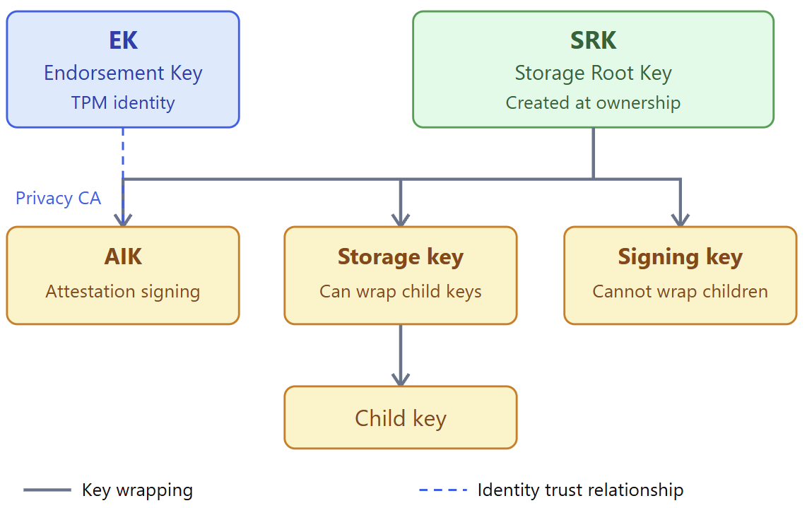
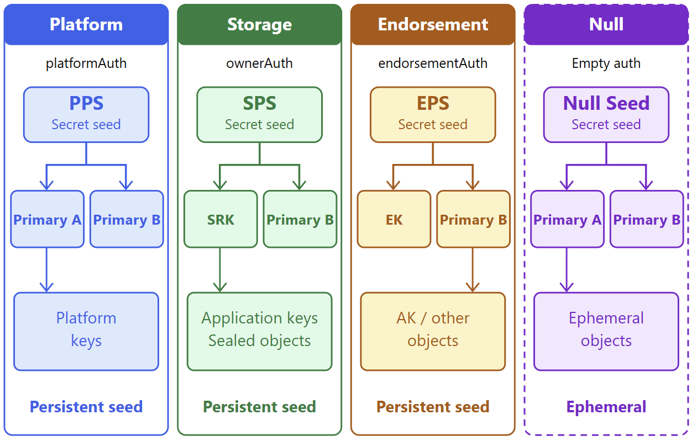
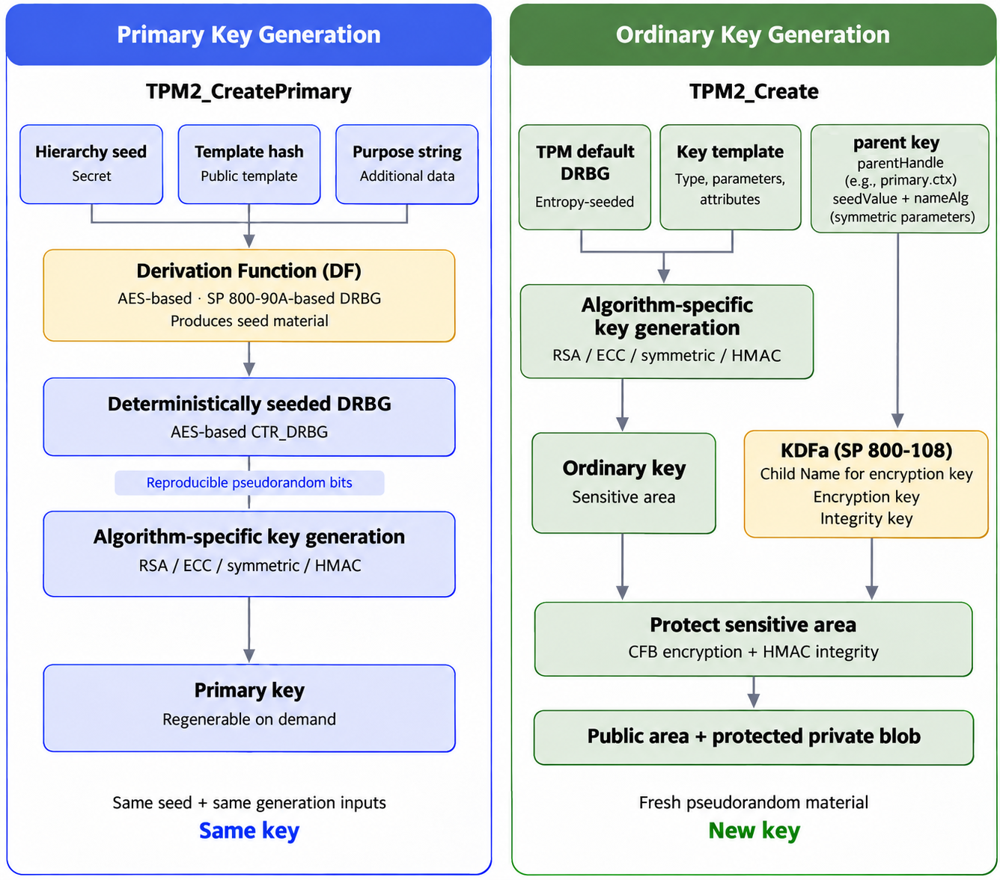
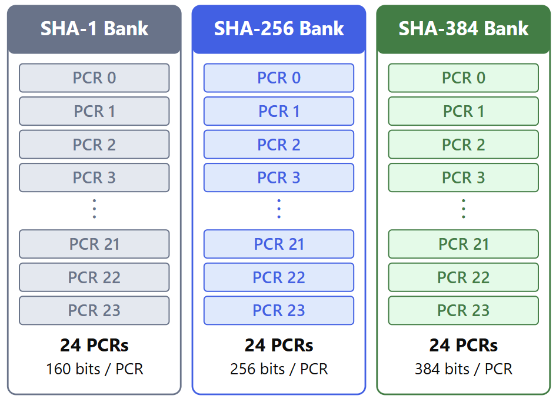
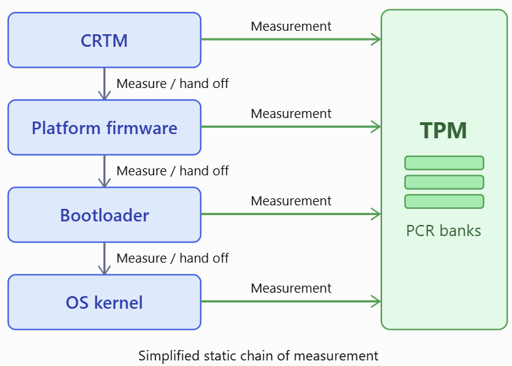
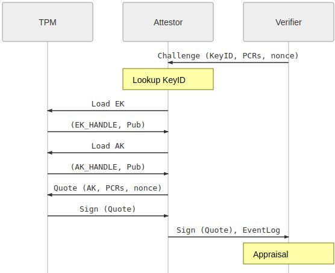

# TPM Internals

This document is a companion to [TPM](01-TPM-intro.md). It covers the internal mechanisms of the Trusted Platform Module in detail — how keys are organized and generated, how boot measurements work, how secrets are protected through sealing and binding, and how remote attestation works.


## Key Hierarchies

Keys are the core of what a TPM protects. A key hierarchy is the way the TPM organizes, protects, and controls access to its keys — which key protects which, who is allowed to use them, and how they are stored. TPM 1.2 and TPM 2.0 take fundamentally different approaches.

### TPM 1.2: single hierarchy

TPM 1.2 uses a single owner-controlled storage hierarchy with one root key for storage and a separate key for identity.



#### Foundational keys

- **Endorsement Key (EK):** A unique RSA-2048 key pair, typically generated during manufacturing (though the TPM 1.2 specification also supports commands for generating it). The EK serves as the TPM's permanent identity — like a serial number that can also participate in cryptographic protocols. The EK is used to establish trust in the TPM (for example, proving to a remote server that the device has a genuine TPM), but it is **not** part of the SRK-rooted storage hierarchy and is not used for general-purpose signing or encryption.

- **Storage Root Key (SRK):** The top of the storage key tree. Created when TPM ownership is established. Every other key the TPM manages is encrypted ("wrapped") by the SRK, or by a key that is itself wrapped by the SRK. This forms a chain: the SRK protects child keys, storage-capable child keys can protect grandchild keys, and so on. Copying a wrapped key blob without access to the SRK is useless — the blob cannot be unwrapped on a different TPM.

#### Key roles

- **Attestation Identity Key (AIK):** Signs attestation statements (such as PCR quotes) to prove the platform's boot state to a remote verifier. AIKs are created under the owner's authority and linked to the EK through a privacy-CA protocol.

- **Application key:** A key created for a specific purpose — signing documents, authenticating the device, or encrypting data. Not every application key can protect child keys — only keys configured as storage keys can act as parents in the key tree.

#### Authorization

A single "owner" authorization controls administrative operations. Individual keys can have their own authorization requirements, and operations such as key creation or sealing may require authorization of the relevant parent key rather than the owner. TPM 1.2 supports delegation of selected privileges. However, there are no independently administered hierarchies — the owner, storage, and identity functions all share the same hierarchy.

#### Limitations

- **Single point of control.** One owner authorization governs the hierarchy. Although individual keys can have their own authorization and delegation is supported, there is no way to split ownership into independently administered domains. On a managed enterprise PC, this creates a conflict: should the IT department own the TPM, or the end user?
- **Limited separation of concerns.** TPM 1.2 does not provide independently administered storage, platform, and endorsement hierarchies. Clearing ownership invalidates the storage hierarchy and its dependent keys, but does not normally replace the Endorsement Key.
- **RSA-based asymmetric cryptography.** TPM 1.2 uses RSA for all asymmetric key operations (typically RSA-2048) and does not support elliptic-curve cryptography.
- **Fixed key structure.** The EK and SRK are fixed at specific positions with fixed algorithms. There is little flexibility to adapt to different platform types.
- **Limited key migration.** TPM 1.2 supports migratable keys (keys created with the `migratable` flag), but the migration mechanism is less flexible and more difficult to manage than TPM 2.0's duplication model.

### TPM 2.0: three persistent hierarchies

TPM 2.0 redesigned the key model from scratch to address the limitations above. Instead of one hierarchy with one owner, TPM 2.0 provides three independent hierarchies, each with its own administrator, its own authorization, and its own root secret.

#### Why the change?

The limitations described above became critical as platforms grew more complex. OEM firmware engineers, OS vendors, and end users each needed independent control over their own keys — not a shared owner password. Privacy preservation required separating the trackable Endorsement Key from everyday storage. New platforms — phones, IoT devices, and automotive ECUs — demanded ECC algorithms and flexible administrative models that TPM 1.2 could not support.

#### The three hierarchies

TPM 2.0 solves these problems by splitting responsibility into three persistent hierarchies plus one ephemeral hierarchy:

- **Platform hierarchy:** Controlled by the platform manufacturer or firmware. Used for maintenance functions and platform-specific keys during early boot. The OEM can use this hierarchy without interfering with the OS or end user.

- **Storage hierarchy:** Controlled by the OS and end user. Used for general-purpose key storage, sealing, and application keys. This is the closest equivalent to the TPM 1.2 owner hierarchy.

- **Endorsement hierarchy:** Controlled by the privacy and attestation administrator. Used for TPM identity and remote attestation. The Endorsement Key lives here, separated from everyday storage keys so that attestation does not unnecessarily reveal the device's identity in unrelated operations.

- **Null hierarchy:** Provides ephemeral keys that do not persist across reboots — useful for short-lived operations like temporary sessions.

Each hierarchy is rooted in a **secret seed** — a large random value protected within the TPM and never exposed through its normal command interface. The table below summarizes all four hierarchies and their seeds:

| Hierarchy | Root seed | Authorization | Handle | Typical authority |
| --- | --- | --- | --- | --- |
| **Platform** | Platform Primary Seed (PPS) | platformAuth | TPM_RH_PLATFORM | Platform firmware / OEM |
| **Storage (Owner)** | Storage Primary Seed (SPS) | ownerAuth | TPM_RH_OWNER | OS or TPM owner |
| **Endorsement** | Endorsement Primary Seed (EPS) | endorsementAuth | TPM_RH_ENDORSEMENT | Privacy / attestation administrator |
| **Null** | Null Seed (temporary) | Empty | TPM_RH_NULL | No hierarchy authorization required |



> TPM 2.0 also defines a **lockout authorization** (lockoutAuth) for dictionary-attack protection. This is not a key hierarchy but a separate administrative authorization.

#### Hierarchy administration

Each persistent hierarchy can be independently enabled, disabled, or have its authorization changed (`TPM2_HierarchyChangeAuth`). For example, an enterprise IT department can manage the Storage hierarchy while the OEM retains control of the Platform hierarchy.

However, the hierarchies are not fully independent. Platform authorization has greater administrative privileges than storage or endorsement authorization. Key administrative commands include:

| Command | Effect |
| --- | --- |
| `TPM2_Clear` | Replaces SPS, resets owner/endorsement authorization, invalidates ordinary objects in storage and endorsement hierarchies (does **not** replace the EPS, so the EK can be recreated) |
| `TPM2_ChangeEPS` | Replaces the Endorsement Primary Seed |
| `TPM2_ChangePPS` | Replaces the Platform Primary Seed |
| `TPM2_HierarchyControl` | Enables or disables hierarchy availability |

#### Key generation and derivation

The TPM creates keys in two ways:

| Generation method | How it works |
| ----------------- | ------------ |
| **Primary key**  | Derived deterministically from a hierarchy seed and a key template. |
| **Ordinary key** | Uses the TPM's Random Number Generator (RNG) to produce fresh, unique key material. |



**Primary keys** are created with `TPM2_CreatePrimary`. The caller provides a **key template**. The template tells the TPM what kind of key to produce:

| Template field | What it specifies | Example |
| --- | --- | --- |
| **Algorithm** | Asymmetric or symmetric type | RSA-2048, ECC P-256, AES-128, HMAC |
| **Hash algorithm** | Hash used to compute the key's Name (its identity digest) | SHA-256, SHA-384 |
| **Object attributes** | Behavioral flags that control what the key can do | See [Object attributes](#object-attributes) |
| **Authorization policy** | Optional policy digest that governs key use | A PCR-based policy, a password, or no policy |
| **Unique field** | Caller-provided data that differentiates keys sharing the same algorithm and hierarchy | Defaults to empty; setting different values produces different primary keys from the same seed |

The TPM combines three inputs:

1. **Hierarchy seed** — the persistent secret for the chosen hierarchy (e.g., the SPS for the Storage hierarchy).

2. **Template hash** — the TPM converts the template to bytes and hashes it into a digest called the key's **Name**. This Name acts as context for the derivation — changing any template field changes the Name and therefore produces a different key.

3. **Purpose string** — a fixed label (`PRIMARY_OBJECT_CREATION`) set by the TPM specification. The caller does not choose it. It prevents key-creation derivations from colliding with other internal TPM derivations.

**Derivation Function (DF).** The three inputs are fed into a block-cipher-based derivation function (Block_Cipher_df, defined in SP 800-90A). The DF condenses them into a single fixed-size seed value.

**Deterministically seeded DRBG.** The DF output seeds an AES-based counter-mode DRBG (CTR_DRBG). This DRBG produces a stream of reproducible pseudorandom bits that drives algorithm-specific key generation — for example, finding suitable prime numbers for an RSA key or computing an ECC point.

Because every input is fixed, the same seed and template always produce the same key. This means primary keys do not need to be stored — they can be regenerated on demand by calling `TPM2_CreatePrimary` with the same template. If an application needs a primary key available immediately at every boot without regeneration, `TPM2_EvictControl` can make it persistent in NV memory.

> Each hierarchy can have multiple primary keys, each generated from a different template.

**Ordinary keys** are created with `TPM2_Create`. The caller provides a template (the same fields as above) and specifies a **parent key** under which the new key will be created. Ordinary keys are also called **child keys** because they always have a parent. This parent–child relationship forms a tree, one per hierarchy.

The parent must be a **storage key** — a key whose attributes include both `restricted` and `decrypt`. Only storage keys carry an internal `seedValue` that the TPM uses to derive the wrapping keys that protect child keys.

The parent key is not involved in generating the key material — it is involved in **protecting** it afterward. The TPM's hardware-entropy-seeded DRBG provides fresh randomness, and the template defines what to generate. Because the randomness is not derived from a fixed seed, an ordinary key cannot be regenerated — if it is lost, it is gone. Once the key material is generated, the TPM wraps the new key's private portion under the parent key and returns two blobs to the host: the public area and the protected private blob. The host must save both. The wrapping mechanism is described in [Key storage](#key-storage).

#### Object attributes

Every key template includes **object attributes** — a set of flags that control what the key can do and how it behaves. The TPM enforces these attributes for the lifetime of the key: once created, they cannot be changed. The most common attributes are:

| Attribute | What it controls |
| --- | --- |
| `fixedTPM` | The key can never leave this TPM — it cannot be duplicated or migrated to another TPM. |
| `fixedParent` | The key stays under its original parent — it cannot be re-wrapped under a different parent key. |
| `sensitiveDataOrigin` | The TPM generated the key's sensitive data internally. If clear, the sensitive data was imported from outside. |
| `restricted` | The key can only operate on TPM-internal structures (e.g., sign only TPM-generated digests, decrypt only TPM-wrapped blobs). Without this flag, the key can operate on arbitrary external data. |
| `decrypt` | The key can perform decryption or unwrapping operations. |
| `sign` | The key can perform signing or HMAC operations. |
| `userwithauth` | The key can be authorized with a simple password (instead of requiring a policy session). |

These attributes combine to define the key's behavior. For example:

- **Storage key** = `restricted` + `decrypt` — can unwrap child keys but only TPM-managed blobs, not arbitrary data. This is the combination required for a key to serve as a [parent key](#key-generation-and-derivation).
- **Signing key** = `sign` (without `restricted`) — can sign arbitrary data provided by the host.
- **Attestation key** = `restricted` + `sign` — can only sign TPM-generated digests (attestation quotes), preventing misuse as a general-purpose signing key.

#### Key roles

The generation methods above (primary and ordinary) describe *how* a key is created. The roles below describe *what* a key is used for. Any role can be either primary or ordinary, depending on the use case.

- **Endorsement Key (EK):** A primary key derived from the Endorsement hierarchy seed. It serves as the TPM's hardware-bound identity. A manufacturer may provision an EK certificate — a signed statement that says "this key belongs to a genuine TPM" — to vouch for the TPM's authenticity. The EK is generally not used for direct signing. Its primary role is **credential activation**: a protocol where a remote party encrypts a secret to the EK, and only the TPM holding that EK can recover it — proving the TPM is genuine.

- **Storage Parent Key:** A primary key derived from the Storage hierarchy seed. It protects (wraps) child keys and sealed data — think of it as a folder that encrypts everything inside it. Other keys and secrets are created as ordinary (child) keys under a storage parent, forming a tree.

   > This is the TPM 2.0 equivalent of the TPM 1.2 [Storage Root Key (SRK)](#tpm-12-single-hierarchy), but the TPM 2.0 specification does not use the term "SRK." Unlike the SRK, which was a single fixed RSA-2048 key, TPM 2.0 allows multiple primary storage keys per hierarchy with different algorithms (RSA or ECC). In practice, industry profiles such as the TCG PC Client Platform TPM Profile define default primary key templates for interoperability, and these are still informally called "SRKs."

- **Attestation Key (AK):** Typically an ordinary (child) key that signs TPM-generated attestation statements — reports of the platform's boot measurements (covered in [PCRs](#platform-configuration-registers-pcrs) and [Remote Attestation](#remote-attestation)). An AK is commonly created under the Endorsement hierarchy, but it can also be created under the Storage hierarchy. Credential activation (`TPM2_ActivateCredential`) establishes a cryptographic link between an AK and an EK, proving the AK resides on a genuine TPM. This is the TPM 2.0 equivalent of TPM 1.2's AIK, but with more flexible creation and authorization.

- **Application key:** Typically an ordinary (child) key created for a specific purpose — signing documents, authenticating a device, or protecting application data. Can use RSA or ECC, depending on what the application needs.

#### Key storage

A TPM has very limited internal memory — typically enough for a handful of simultaneously loaded objects and a small area of non-volatile (NV) storage. It cannot hold dozens of application keys at once the way a filesystem can hold thousands of files. The TPM solves this by allowing most key objects to live *outside* the TPM as encrypted blobs that are loaded back on demand.

A key can reside in one of three places:

| Residency              | Where            | Survives reboot? | Capacity |
| ---------------------- | ---------------- | --- | --- |
| **Loaded (transient)** | TPM volatile RAM | No | Very small — typically 3 to 7 objects simultaneously (reported by `TPM2_PT_HR_LOADED_MIN`) |
| **Persistent**         | TPM NV memory    | Yes | Very small — limited by the TPM's NV storage capacity |
| **External (wrapped)** | Host filesystem  | Yes (on disk) | Unlimited — stored as encrypted blobs outside the TPM |

**Loaded keys** are created with `TPM2_CreatePrimary` or loaded with `TPM2_Load` and exist in TPM RAM only until they are flushed, context-saved, or the TPM is reset.

**Persistent keys** are ordinary loaded keys that have been assigned to a permanent NV handle using `TPM2_EvictControl`. They survive reboots without being reloaded, but they consume precious NV storage. Only a few keys should be made persistent — typically the primary keys that are needed immediately at every boot.

**External keys** are the standard approach for most application keys. When a child key is created with `TPM2_Create`, the TPM returns two blobs: the public portion and the private portion encrypted (wrapped) by the parent key. The host software saves both to the filesystem. When the key is needed later, the host calls `TPM2_Load` with the parent context and the saved blobs — the TPM decrypts the private blob, verifies its integrity, and makes the key available for use. After the operation, the key can be flushed to free the slot.

This load-on-demand cycle is how the TPM supports an unlimited number of keys despite having room for only a few at a time:

1. **Create** — `TPM2_Create` generates the key. The TPM returns the public and wrapped private blobs. The host saves them to disk.
2. **Load** — When the key is needed, `TPM2_Load` decrypts the private blob using the parent key and loads the key into TPM RAM.
3. **Use** — The host issues commands (sign, decrypt, unseal) using the loaded key.
4. **Flush** — `TPM2_FlushContext` removes the key from TPM RAM, freeing the slot for another key.

The kernel resource manager (`/dev/tpmrm0`) and the `tpm2-abrmd` daemon automate this cycle transparently using `TPM2_ContextSave` and `TPM2_ContextLoad` — swapping objects in and out of TPM RAM as needed, so that applications do not have to manage slots manually.

**Why external blobs are secure.** The wrapped private blob is encrypted with a symmetric key derived from the parent key and integrity-protected with an HMAC. For a non-migratable key (one with the `fixedTPM` attribute set), the blob can only be unwrapped by the TPM that created it. Copying the file to another machine or reading it from disk reveals nothing — without the parent key inside the original TPM, the blob is opaque.

**Primary keys have an additional advantage:** because they are derived deterministically from a hierarchy seed and a template, they do not need to be saved as blobs at all. They can be regenerated at any time with `TPM2_CreatePrimary` using the same template. This saves both NV space and filesystem space, at the cost of a relatively expensive cryptographic derivation each time.


## Platform Configuration Registers (PCRs)

Platform Configuration Registers (PCRs) are special-purpose registers inside the TPM that record what software ran during the boot process. Think of them as a tamper-evident logbook: each boot stage writes an entry, and no one can erase or alter previous entries. If anything in the boot sequence changes — a firmware update, a different bootloader, or a rootkit — the PCR values change too.

> **Note:** The TCG specification allows different physical implementations of PCR storage, but the PC Client Platform TPM Profile recommends RAM because PCRs may be updated frequently during a boot cycle.

A TPM typically has **24 PCRs** (indices 0–23), each holding a single hash value. The TPM maintains a separate set of 24 PCRs for each supported hash algorithm — called a **PCR bank** (for example, a SHA-256 bank and a SHA-384 bank).



When a system starts or restarts, the TPM must decide what to do with its PCR values. The behavior depends on the type of startup:

| TPM operation | PCR behavior |
| --- | --- |
| **TPM Reset** | All PCRs reinitialized to their default values |
| **TPM Restart** | All PCRs reinitialized to their default values |
| **TPM Resume** | Designated PCR values (PCRs 0–15) restored from saved state; other PCRs reinitialized |

According to the TCG PC Client Platform TPM Profile, the default initial values on `Startup(CLEAR)` are:

| PCR | Initial value |
| --- | --- |
| 0 | Startup locality indicator or hardware measurement sequence result |
| 1–16, 23 | All zeros (0x00…00) |
| 17–22 | All ones (0xFF…FF) — reserved for Dynamic Root of Trust for Measurement (D-RTM) |

### How extend works

Software cannot directly overwrite a PCR with an arbitrary value — it can only **extend** it. Extending means: take the register's current value, append the new measurement, and hash them together to produce a new value:

```
PCR_new = Hash( PCR_old || measurement_digest )
```

Where `||` means concatenation. In plain terms: the TPM takes the existing PCR value, appends the new measurement digest, and hashes the combined result. The output becomes the new PCR value.

This makes each PCR a **one-way accumulator**. You cannot undo an extend, and you cannot skip to a desired value. Each extend changes the register in a way that reflects the complete, ordered history of everything that was measured into it. Swapping the order of two measurements produces a different final PCR value — so the result captures not just *what* was measured, but *in what order*.

Certain PCRs (such as PCR 16 and PCR 23 on PC Client platforms) also support reset operations under conditions defined by the platform specification.

### What gets measured into which PCR

The assignment of PCRs depends on the platform specification. The general pattern is: lower-numbered PCRs (0–7) record firmware and boot infrastructure, middle PCRs (8–15) are for OS use, and higher PCRs (16–23) serve special purposes such as debugging, dynamic trust establishment, and application-specific measurements.

For a typical **TCG PC Client** platform:

| PCR | What is typically measured |
| --- | --- |
| 0 | CRTM and platform firmware code |
| 1 | Platform firmware configuration |
| 2 | External or third-party firmware code, UEFI drivers and Option ROMs |
| 3 | External firmware configuration and data |
| 4 | Boot manager code and boot attempts |
| 5 | Boot configuration and GPT partition information |
| 6 | Host platform manufacturer-specific measurements |
| 7 | Secure Boot policy and verification authorities |
| 8–15 | Static OS-defined measurements (exact use depends on OS and bootloader) |
| 16 | Debug and test (resettable) |
| 17 | D-RTM, locality 4 |
| 18 | D-RTM, locality 3 |
| 19 | D-RTM, locality 2 |
| 20 | D-RTM, locality 1 |
| 21–22 | Dynamic OS-controlled measurements |
| 23 | Application-specific measurements |

### Measurement chain

The TPM does not independently inspect the platform's boot components — it is a passive recorder, not an inspector. It has no way to read firmware off a flash chip or examine the bootloader. Instead, each boot stage is responsible for measuring the next stage and sending those measurements to the TPM via commands such as `TPM2_PCR_Extend` and `TPM2_PCR_Event` (the latter allows the TPM to hash the event data internally).

This creates a chain of measurements, and every chain needs a trusted starting point. In a **Static Root of Trust for Measurement (S-RTM)**, that starting point is the **Core Root of Trust for Measurement (CRTM)** — typically the very first code that executes when the platform powers on. The CRTM must be protected against unauthorized modification and may be implemented using immutable code, securely updatable firmware, or hardware-assisted mechanisms.

From there, each subsequent boot stage (bootloader, OS kernel, drivers) measures the next stage before transferring execution. The TPM accumulates these measurements in its PCRs, building up a cryptographic record of the entire boot sequence.



### Event log

The PCR itself does not explain *what* was measured — it only holds a cumulative hash value. A separate **event log**, maintained by firmware and OS software outside the TPM, records the details: which file was measured, which configuration was checked, and what hash was produced. A verifier replays the event log entries, recomputes the expected PCR values, and checks them against the actual PCR values to confirm consistency.

### Why PCRs matter

- **Sealing:** A disk-encryption key can be sealed to expected PCR values. If changes to firmware or the bootloader affect the PCRs selected by the sealing policy, the TPM refuses to release the key.

- **Attestation:** A remote server can request a signed TPM **quote** — a TPM-signed snapshot of selected PCR values — and compare them against a known-good policy (see [Remote Attestation](#remote-attestation) for the full workflow).

- **Tamper detection:** Changes to measured boot components or security-relevant configuration normally result in different PCR values. Detection depends on the coverage and integrity of the measurement chain — PCRs cannot detect unmeasured components or runtime modifications that occur after measurements are taken.

## Sealing and Binding

The TPM uses two related operations to protect secrets. Both rely on the cryptographic hardware, key hierarchies, and PCRs described above.

### Sealing

**Sealing** protects a secret within a TPM-managed object and associates authorization requirements with its release. The sealed object may be stored outside the TPM as an encrypted, integrity-protected blob. When requested, the TPM releases the secret only if the object's authorization requirements are satisfied.

Think of it as putting a note in a safe that only opens when the right combination of factors is present — for example, the machine booted the expected firmware *and* the correct PIN was entered. If anything in that combination changes, the safe stays locked. Sealing commonly uses PCR-based policies, but TPM 2.0 also supports other authorization mechanisms (passwords, complex compound policies).

For example, full-disk encryption tools like BitLocker seal the disk-encryption key to expected PCR values (as described in [How TPM Is Used in Practice](01-TPM-intro.md#how-tpm-is-used-in-practice)). If the boot measurements change — because of a firmware update or tampering — the TPM refuses to unseal the key, and the drive stays locked.

### Binding

**Binding** encrypts data with a TPM key so that only that specific TPM can decrypt it — provided the decryption key is non-migratable and has not been made available elsewhere. You can copy the encrypted blob to a USB drive, upload it to the cloud, or email it — it is useless without the TPM that holds the binding key. It is like locking a file with a key that physically cannot leave the building.

In TPM 2.0, decryption keys can themselves have PCR-based authorization policies, blurring the line between binding and sealing. The distinction is clearest in TPM 1.2, which provides separate commands (`TPM_UnBind` vs. `TPM_Seal`/`TPM_Unseal`).

In short: **sealing** protects a secret inside a TPM-managed object with authorization requirements (commonly including PCR-based policies). **Binding** ties encrypted data to a specific TPM through a non-migratable decryption key. In TPM 2.0, flexible authorization policies make the distinction less rigid than in TPM 1.2.

## Remote Attestation

**Attestation** lets a device prove to a remote party what state it is in. It combines PCR measurements and the TPM's signing capability into one signed statement. The process involves two roles:

- **Attestor** — the device being verified. This is typically a laptop, server, IoT device, or any platform equipped with a TPM. The attestor's software coordinates with its local TPM to produce evidence of the platform's boot state.

- **Verifier** — the party requesting proof. This is typically a remote server, network gateway, or management service that decides whether to trust the attestor — for example, before granting network access, issuing a certificate, or allowing a VPN connection.



A typical remote attestation workflow:

1. The **verifier** sends a **challenge** to the **attestor**, specifying a fresh random **nonce**, which **PCRs** to include, and a **key identifier** for the attestation key to use.

2. The attestor loads the **Endorsement Key (EK)** and the **Attestation Key (AK)** into the TPM.

3. The attestor asks the TPM to produce a **quote** using `TPM2_Quote`, specifying the AK, the selected PCRs, and the nonce.

4. The TPM constructs a **digest** over the selected PCR values, combines it with the nonce and additional metadata, and signs the resulting structure with the AK. The signed quote contains the PCR digest — not the individual PCR values.

5. The attestor returns the signed quote, along with supporting evidence such as individual PCR values and the firmware/OS-maintained boot **event log**, to the verifier. The event log is maintained by software outside the TPM; the quote's signature covers the PCR digest and nonce, not the event log itself.

6. The verifier performs **appraisal** by checking:
   - **AK trust.** The AK traces back to a genuine TPM — typically established beforehand through an enrollment ceremony using `TPM2_ActivateCredential` and the EK certificate chain. The verifier should also validate the AK's public attributes to confirm it is an appropriately configured TPM-protected attestation key.
   - **Signature validity.** The quote's signature verifies under the trusted AK.
   - **Freshness.** The nonce matches, proving the response is not replayed from an earlier session.
   - **Event-log integrity.** The verifier replays the event-log entries, computes the expected PCR values independently, and checks whether a digest of those values matches the PCR digest inside the signed quote. This confirms the measurement digests are consistent — it does not necessarily authenticate every descriptive metadata field in the event log.
   - **Policy evaluation.** The verifier evaluates the measurements against trusted reference values and acceptance policies, rather than necessarily requiring one fixed boot sequence.

The nonce prevents replay — an attacker cannot save an old quote and send it again, because the nonce will be different each time.

Attestation does not by itself make a device trustworthy. It gives the verifier evidence to make a trust decision.

## References

| Reference | Relevant topics |
| --- | --- |
| [TCG TPM 1.2 Main Specification](https://trustedcomputinggroup.org/resource/tpm-main-specification/) | EK, SRK, AIK, ownership |
| [TPM 2.0 Library Part 1: Architecture, revision 185](https://trustedcomputinggroup.org/resource/tpm-library-specification/) | Hierarchies, seeds, PCRs, authorization |
| [TCG PC Client Platform TPM Profile v1.07](https://trustedcomputinggroup.org/resource/pc-client-platform-tpm-profile-ptp-specification/) | PCR attributes, initialization and reset |
| [TCG PC Client Platform Firmware Profile](https://trustedcomputinggroup.org/resource/pc-client-specific-platform-firmware-profile-specification/) | Measured boot, CRTM, event logs |
| [Infineon SLI/SLM 9670 Security Policy](https://csrc.nist.gov/projects/cryptographic-module-validation-program/certificate/4034) | Physical TPM architecture |
| [RFC 9683 — Remote Integrity Verification](https://datatracker.ietf.org/doc/rfc9683/) | Remote attestation |

---

[← Previous: TPM](01-TPM-intro.md) · [Next: TPM 2.0 Software Stack →](03-TPM-software-stack.md)
