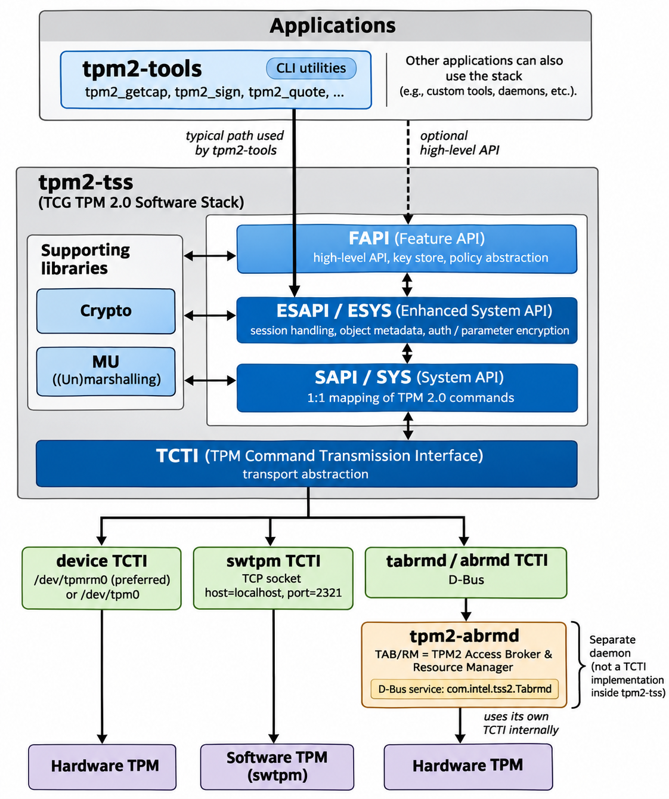

# TPM 2.0 Software Stack

This document describes the software components that allow applications to communicate with a TPM 2.0 — the libraries, command-line tools, and resource managers that form the bridge between user-space software and the TPM hardware (or emulator).


## Overview

The TPM is a passive device — it accepts commands and returns responses, but it does not initiate actions on its own. Software must send correctly formatted command structures to the TPM and interpret the responses. Think of it like a hardware calculator: it performs operations when asked, but someone must press the buttons.

The **TPM 2.0 Software Stack (TSS)** is a standardized software architecture defined by the Trusted Computing Group (TCG) that specifies how applications should communicate with a TPM. Implementations such as `tpm2-tss` provide the libraries that make this possible.

On Linux, the TPM 2.0 software ecosystem consists of three main packages:

| Package        | Role               |
| -------------- | ------------------ |
| **tpm2-tss**   | Foundation libraries — implements the TCG-specified software stack layers |
| **tpm2-tools** | Command-line utilities for performing TPM operations and related tasks, built on tpm2-tss |
| **tpm2-abrmd** | Optional userspace resource manager daemon — manages concurrent TPM access |

The diagram below shows how these components fit together — from applications at the top, through the tpm2-tss API layers (FAPI, ESAPI, SAPI), down to the TCTI transport modules that connect to a hardware TPM, software TPM, or the tpm2-abrmd resource manager.




## tpm2-tss — the foundation library

[tpm2-tss](https://github.com/tpm2-software/tpm2-tss) implements the Trusted Computing Group's TPM 2.0 Software Stack. It is not a tool you run directly — it is the set of libraries that everything else is built on.

The stack consists of API layers, transport modules, and supporting libraries. Applications choose which API level to use depending on how much control they need — higher levels are simpler, lower levels offer more flexibility:

| Component | Library | Responsibility |
| --- | --- | --- |
| **FAPI** (Feature API) | `libtss2-fapi` | High-level operations with a built-in key store, policy management, and cryptographic profiles — designed for applications that need TPM functionality without deep TPM knowledge |
| **ESAPI** (Enhanced System API) | `libtss2-esys` | Command-level API with session handling, object metadata tracking, HMAC computation, and parameter encryption — this is the layer that `tpm2-tools` primarily uses |
| **SAPI** (System API) | `libtss2-sys` | Low-level command construction, execution, and response processing — a 1-to-1 mapping of every TPM 2.0 command (see [Command interface](01-TPM-intro.md#1-command-interface)) |
| **TCTI** (TPM Command Transmission Interface) | `libtss2-tcti-device`, `libtss2-tcti-swtpm`, etc. | Transmits TPM commands and receives responses. Different TCTI modules exist for different transports — this abstraction is why the same commands work with both hardware and software TPMs |
| **TCTI Loader** | `libtss2-tctildr` | Dynamically loads and initializes a TCTI module and forwards TCTI operations to the selected backend |
| **MU** (Marshaling/Unmarshaling) | `libtss2-mu` | Serializes and deserializes TPM data structures — converts between in-memory C structures and the byte-level format the TPM expects. Used internally by SAPI and ESAPI; not a layer applications call directly |

Both ESAPI and SAPI provide a command-level mapping of TPM 2.0 operations — meaning each TPM specification command has a corresponding function. ESAPI adds functionality on top of SAPI (session management, HMAC computation, parameter encryption) rather than replacing command-level operations with higher-level abstractions.

In practice, the typical call path is: `tpm2-tools` → ESAPI → SAPI (with MU for serialization) → TCTI → TPM. Each layer handles its responsibility and delegates downward.

### TCTI: the transport abstraction

The TCTI layer deserves special attention because it is what makes the software stack portable across different TPM environments. Each TCTI module implements the same interface but talks to a different backend:

| TCTI module | Backend | Typical use |
| --- | --- | --- |
| `tcti-device` | `/dev/tpmrm0` or `/dev/tpm0` | Linux TPM device access (hardware TPMs, firmware TPMs, and virtual TPMs exposed through kernel drivers) |
| `tcti-swtpm` | TCP or Unix-domain socket | Software TPM emulator (`swtpm`) |
| `tcti-mssim` | TCP socket (Microsoft simulator protocol) | IBM or Microsoft TPM simulator |
| `tcti-tabrmd` | D-Bus and Unix IPC to `tpm2-abrmd` | When using the userspace resource manager |
| `tcti-tbs` | Windows TBS (TPM Base Services) API | Windows native TPM access |
| `tcti-libtpms` | In-process `libtpms` library | TPM emulation without a separate daemon |

Different software configures the TCTI in different ways:

- **`tpm2_*` command-line tools** — select per-command with the `-T` flag, or set the `TPM2TOOLS_TCTI` environment variable (applies to the current shell and its child processes).
- **`tss2_*` FAPI tools** — configured through the FAPI configuration file.
- **C applications** — use the TCTI initialization API directly.
- **OpenSSL TPM provider** — uses the `TPM2OPENSSL_TCTI` environment variable.

> Explicitly selecting a TCTI is recommended over relying on automatic selection, because the TCTI Loader's default fallback order may not match your intended configuration. The documented fallback sequence tries `libtss2-tcti-default.so` first, then `tabrmd`, then `device:/dev/tpmrm0`, then `/dev/tpm0`, then `swtpm`, then `mssim` — though actual selection depends on installed modules and build configuration.

```bash
# Use the Linux kernel resource manager (hardware TPM)
export TPM2TOOLS_TCTI="device:/dev/tpmrm0"

# Use a software TPM over TCP
export TPM2TOOLS_TCTI="swtpm:host=localhost,port=2321"

# Use a software TPM over a Unix socket
export TPM2TOOLS_TCTI="swtpm:path=/tmp/swtpm.sock"

# Use the userspace resource manager
export TPM2TOOLS_TCTI="tabrmd"
```

This design allows applications to use the same TPM command interface with different TPM implementations — just by changing the TCTI configuration. However, the TPM implementations themselves are not identical. Differences in capabilities (supported algorithms, available PCR banks, NV storage capacity, object and session limits) and persistent state (hierarchy seeds, TPM-bound keys) may require additional configuration when switching between implementations.


## tpm2-tools — the command-line interface

[tpm2-tools](https://github.com/tpm2-software/tpm2-tools) is the package you interact with directly from the command line. It primarily provides `tpm2_*` utilities built on the ESAPI layer of `tpm2-tss`. When built with FAPI support, it also provides `tss2_*` utilities that expose higher-level TPM operations through FAPI (for example, `tss2_createkey`, `tss2_sign`, `tss2_quote`).

Most `tpm2_*` utilities map to one or more TPM 2.0 specification commands (see [Command interface](01-TPM-intro.md#1-command-interface)). The table below shows common examples. Some utilities perform entirely software-based operations and do not require a TPM connection — for example, `tpm2_checkquote` for quote verification or `tpm2_eventlog` for event-log parsing.

| CLI command | TPM specification command | Description |
| --- | --- | --- |
| `tpm2_getcap` | `TPM2_GetCapability` | Query TPM properties and supported features |
| `tpm2_getrandom` | `TPM2_GetRandom` | Generate random bytes |
| `tpm2_pcrread` | `TPM2_PCR_Read` | Read PCR values |
| `tpm2_pcrextend` | `TPM2_PCR_Extend` | Extend a measurement into a PCR |
| `tpm2_createprimary` | `TPM2_CreatePrimary` | Create a primary key from a hierarchy seed and template |
| `tpm2_create` | `TPM2_Create` / `TPM2_CreateLoaded` | Create a child key under a storage parent |
| `tpm2_load` | `TPM2_Load` | Load an externally stored key into TPM RAM |
| `tpm2_sign` | `TPM2_Sign` | Sign a digest using a TPM key |
| `tpm2_verifysignature` | `TPM2_VerifySignature` | Verify a signature |
| `tpm2_unseal` | `TPM2_Unseal` | Release a sealed secret |
| `tpm2_quote` | `TPM2_Quote` | Produce a signed attestation of selected PCR values |
| `tpm2_evictcontrol` | `TPM2_EvictControl` | Make a transient object persistent, or remove a persistent object |
| `tpm2_nvdefine` | `TPM2_NV_DefineSpace` | Define an NV storage index |
| `tpm2_nvwrite` | `TPM2_NV_Write` | Write data to an NV index |
| `tpm2_nvread` | `TPM2_NV_Read` | Read data from an NV index |

Some CLI tools are convenience wrappers that combine multiple specification commands. For example, `tpm2_createek` calls `TPM2_CreatePrimary` with a standard EK template, and `tpm2_createak` combines key creation with attestation-specific configuration.

TPM-connected `tpm2_*` utilities support the `-T` (or `--tcti`) flag to override the TCTI selection for that single command. Utilities that perform only software-based operations also support `-T none`.


## tpm2-abrmd — the userspace resource manager

[tpm2-abrmd](https://github.com/tpm2-software/tpm2-abrmd) (TPM2 Access Broker and Resource Manager Daemon) is a system daemon that manages concurrent TPM access from multiple processes. It serializes commands, tracks sessions, and isolates object contexts per client — ensuring that one application's TPM usage does not interfere with another's. Communication between the daemon and its clients uses D-Bus for connection establishment and Unix-domain sockets for transferring TPM commands and responses.

**For basic TPM experiments on modern Linux, you probably do not need it.** Since Linux 4.12, the kernel provides an in-kernel resource manager at `/dev/tpmrm0` that handles most of the same responsibilities. However, `tpm2-abrmd` remains useful for some advanced workloads — see session ungapping below.

| Access path | Device / interface | Resource management | When to use it |
| --- | --- | --- | --- |
| **Kernel RM** | `/dev/tpmrm0` | Kernel-managed transient objects and session contexts | Recommended for ordinary TPM access on modern Linux (4.12+) |
| **Userspace RM** | `tcti-tabrmd` (D-Bus + Unix-domain sockets) | Daemon-managed contexts with session ungapping | Advanced workloads or platforms without a suitable kernel RM |
| **Raw access** | `/dev/tpm0` | No automatic resource management; caller manages TPM resources | Low-level debugging, resource managers, or specialized applications |

One advantage `tpm2-abrmd` retains over the kernel RM is **session ungapping**. The TPM assigns sequence numbers to saved session contexts, and these numbers must stay within a certain range of each other. When many sessions are repeatedly saved and loaded, the gap between sequence numbers can grow too large, causing the TPM to reject older sessions with a `TPM2_RC_CONTEXT_GAP` error. Session ungapping refreshes saved session contexts to keep their sequence numbers in range. This matters most in complex, long-running cryptographic workloads that maintain multiple concurrent sessions.


## Other TPM software

TPM libraries also exist for other languages and platforms:

| Software | Category | Language | Description |
| --- | --- | --- | --- |
| [TSS.MSR](https://github.com/microsoft/TSS.MSR) | Software stack | C#, C++, Java, Python, TypeScript (Node.js) | Microsoft's collection of TPM 2.0 software libraries |
| [go-tpm](https://github.com/google/go-tpm) | Native TPM library | Go | TPM access without requiring the C TSS |
| [tpm2-pytss](https://github.com/tpm2-software/tpm2-pytss) | Language bindings | Python | Python bindings for tpm2-tss, including ESAPI, FAPI, MU, and TCTI |
| [tpm2-pkcs11](https://github.com/tpm2-software/tpm2-pkcs11) | Integration library | C | TPM-backed PKCS#11 implementation — integrates with OpenSSL, SSH, and browsers |
| [tpm2-openssl](https://github.com/tpm2-software/tpm2-openssl) | Integration library | C | OpenSSL 3.x provider for TPM-backed cryptographic operations |
| [swtpm](https://github.com/stefanberger/swtpm) | Emulator | C | Software TPM 2.0 implementation based on libtpms, for development and virtual machines |

On Windows, **TPM Base Services (TBS)** provides centralized access to the TPM — it plays a role similar to the Linux kernel's `/dev/tpmrm0`. Applications can submit TPM commands directly through TBS or use higher-level cryptographic interfaces such as the Cryptography API: Next Generation (CNG) Platform Crypto Provider. Windows security features like Windows Hello and BitLocker access TPM capabilities through these interfaces.


## References

| Reference | Relevant topics |
| --- | --- |
| [tpm2-tss documentation](https://tpm2-tss.readthedocs.io/) | Software stack architecture (FAPI, ESAPI, SAPI, TCTI) |
| [tpm2-tss — TCTI documentation](https://github.com/tpm2-software/tpm2-tss/blob/master/doc/tcti.md) | Transport modules, TCTI Loader, default selection fallback order |
| [tpm2-tools documentation](https://tpm2-tools.readthedocs.io/) | Command reference for all `tpm2_*` and `tss2_*` utilities |
| [tpm2-tools — TCTI configuration](https://github.com/tpm2-software/tpm2-tools/blob/master/man/common/tcti.md) | CLI transport options and environment variables |
| [tpm2-abrmd on GitHub](https://github.com/tpm2-software/tpm2-abrmd) | Userspace resource manager |
| [tpm2-software community — version matrix](https://tpm2-software.github.io/versions/) | Compatible versions of tpm2-tools, tpm2-tss, and tpm2-abrmd |
| [TCG TSS 2.0 Overview and Common Structures](https://trustedcomputinggroup.org/resource/tss-overview-common-structures-specification/) | The specification that defines the TSS layer architecture |
| [Microsoft — TPM Base Services](https://learn.microsoft.com/en-us/windows/win32/tbs/tpm-base-services-portal) | Windows TPM access architecture |
| [swtpm on GitHub](https://github.com/stefanberger/swtpm) | Software TPM emulator |

---

[← Previous: TPM Internals](02-TPM-internals.md) · [Next: TPM 2.0 Lab Setup →](04-TPM-lab-setup.md)
