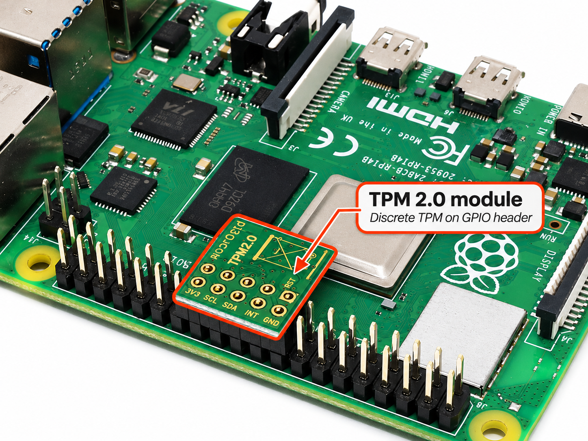
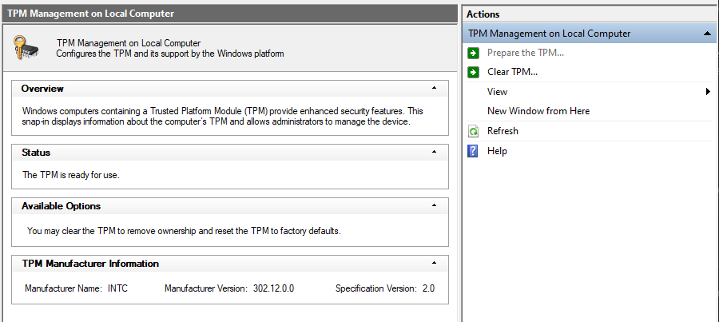

# TPM 2.0 Lab Setup

This document covers everything you need before running TPM commands — choosing a TPM environment, verifying that a TPM is present, installing the tools, and setting up a software TPM emulator for safe experimentation.

For the hands-on exercises themselves, see [TPM 2.0 Lab Exercises](05-TPM-lab-exercises.md).


## Choosing Your TPM Environment

Before running any TPM commands, you need access to a TPM 2.0. There are three practical options:

| Option | What it is | Pros | Cons |
| --- | --- | --- | --- |
| **Hardware TPM** | A physical discrete TPM chip or firmware TPM (fTPM) built into your CPU — see [TPM Implementations](01-TPM-intro.md#tpm-implementations) | Real security boundary; production-representative behavior | Risk of locking yourself out if you change hierarchy authorizations carelessly; firmware updates may change PCR values |
| **Software TPM (swtpm)** | A TPM 2.0 emulator running entirely in software — see [swtpm on GitHub](https://github.com/stefanberger/swtpm) | Safe for experimentation; can be reset or destroyed freely; works on any Linux system including WSL2 | No hardware security boundary — secrets exist in process memory; not suitable for production |
| **Virtual TPM (vTPM)** | A TPM interface presented to a virtual machine guest, typically backed by swtpm or a hypervisor security service | Isolated environment; can snapshot and restore VM state | Requires a hypervisor setup (QEMU/KVM, Hyper-V, etc.) |

**Recommendation for learning:** Use `swtpm`. It behaves identically to a real TPM from the command-line perspective, you can reset it at any time, and there is no risk to your system. The commands you learn transfer directly to hardware TPMs — only the transport layer changes.


## Checking for a Hardware TPM

If you want to use a real TPM instead of (or in addition to) the software emulator, the first step is verifying that one is present and accessible.

### Linux (bare-metal)

The Linux kernel exposes a detected TPM through two device nodes:

| Device | Description |
| --- | --- |
| `/dev/tpm0` | Raw TPM access — only one process can use it at a time, with no resource management |
| `/dev/tpmrm0` | Kernel-managed resource manager (Linux 4.12+) — multiplexes access for multiple processes, manages sessions and object contexts automatically |

For normal use, **`/dev/tpmrm0` is the recommended interface**. It is what `tpm2-tools` uses by default.

To check if a TPM is present:

```bash
# Check for TPM device nodes
ls -l /dev/tpm0 /dev/tpmrm0

# Check the TPM version (should print "2" for TPM 2.0)
cat /sys/class/tpm/tpm0/tpm_version_major

# Check kernel log for TPM detection messages
sudo dmesg | grep -i tpm

# systemd convenience check (if systemd is available)
systemd-analyze has-tpm2
```

If `/dev/tpm0` does not exist, the TPM may be disabled in the BIOS/UEFI firmware settings. Look for a setting labeled "TPM", "Security Device", "Intel PTT" (for Intel firmware TPMs), or "AMD fTPM" (for AMD firmware TPMs) and enable it.

### Raspberry Pi (discrete TPM)

Raspberry Pi boards do not include a built-in TPM. However, a discrete TPM 2.0 chip can be added via an external module that connects to the 40-pin GPIO header. Depending on the chip, communication uses the SPI or I²C bus (see [Host interface](01-TPM-intro.md#5-host-interface)).

| TPM chip          | Interface | Example module |
| ----------------- | --------- | --- |
| Infineon SLB 9670 | SPI       | Infineon Iridium, LetsTrust TPM |
| Infineon SLB 9672 | SPI       | OPTIGA TPM SLB 9672 RPI Evaluation Board |
| Infineon SLB 9673 | I²C       | OPTIGA TPM SLB 9673 RPI Evaluation Board |

These are physical TPM 2.0 chips with their own hardware security boundary — identical in capability to the discrete TPMs found in PCs and servers.




#### Step 1 — Install the TPM module

Power off the Raspberry Pi and attach the TPM module to the GPIO header according to the manufacturer's instructions. Ensure the module is correctly oriented and its pins are properly aligned.

#### Step 2 — Enable the TPM interface and Device Tree overlay

Unlike conventional PCs where TPM configuration is performed through BIOS/UEFI settings, the Raspberry Pi uses **Device Tree overlays** to describe attached hardware to the Linux kernel.

Edit the boot configuration file:

```bash
sudo nano /boot/firmware/config.txt
```

> **Note:** On Raspberry Pi OS versions prior to Bookworm, the file is located at `/boot/config.txt` instead.

Add the appropriate configuration under the `[all]` section, depending on the TPM model:

**SLB 9670 or SLB 9672 (SPI):**

```ini
dtparam=spi=on
dtoverlay=tpm-slb9670
```

**SLB 9673 (I²C):**

```ini
dtparam=i2c_arm=on
dtoverlay=tpm-slb9673
```

The Device Tree overlay tells the kernel which bus and driver to use for the TPM chip. Both configurations are documented in [Infineon's TPM Explorer setup guide](https://github.com/Infineon/optiga-tpm-explorer).

Save the file and reboot:

```bash
sudo reboot
```

#### Step 3 — Verify TPM detection

After reboot, verify with the same commands as bare-metal Linux:

```bash
# Check for TPM device nodes
ls -l /dev/tpm0 /dev/tpmrm0

# Check the TPM major version (should print "2")
cat /sys/class/tpm/tpm0/tpm_version_major

# Check kernel detection messages
sudo dmesg | grep -i tpm
```

If `/dev/tpm0` does not appear, double-check the overlay name in `config.txt`, confirm the module is seated correctly on the GPIO header, and review `dmesg` output for driver errors.

### Linux VM with vTPM

A virtual TPM (vTPM) is presented to the guest by the hypervisor. From inside the guest, it looks and behaves exactly like a hardware TPM — the same `/dev/tpm0` and `/dev/tpmrm0` device nodes appear, and all the same commands work.

The setup depends on your hypervisor:

| Hypervisor | How to add a vTPM |
| --- | --- |
| **QEMU/KVM** | Add `--tpmdev emulator` and `-device tpm-tis` to the QEMU command line, backed by an `swtpm` instance |
| **Proxmox VE** | VM → Hardware → Add → TPM State (requires `swtpm` installed on the Proxmox host; select TPM version 2.0) |
| **Hyper-V** | VM Settings → Security → Enable Trusted Platform Module |
| **VMware** | VM Settings → Add TPM module (requires VM encryption or key provider) |
| **virt-manager** | Add Hardware → TPM → Type: Emulated, Model: TIS |

Once the VM boots, verify with the same commands as bare-metal:

```bash
ls -l /dev/tpm0 /dev/tpmrm0
cat /sys/class/tpm/tpm0/tpm_version_major
```

If the device nodes do not appear, confirm that the vTPM was added in the hypervisor settings and that the guest kernel has TPM driver support (`CONFIG_TCG_TPM`, `CONFIG_TCG_TIS`, or `CONFIG_TCG_CRB` enabled).

### Windows

Windows provides two built-in methods:

**PowerShell** (run as Administrator):

```powershell
Get-Tpm
```

Sample output from a system with an Intel firmware TPM (PTT):

```
TpmPresent                : True
TpmReady                  : True
TpmEnabled                : True
TpmActivated              : True
TpmOwned                  : True
RestartPending            : True
ManufacturerId            : 1229870147
ManufacturerIdTxt         : INTC
ManufacturerVersion       : 302.12.0.0
ManufacturerVersionFull20 : 302.12.0.0
ManagedAuthLevel          : Full
OwnerAuth                 : uuph/SA8tlSDFBfN01hWRtslMoc=
OwnerClearDisabled        : False
AutoProvisioning          : Enabled
LockedOut                 : False
LockoutHealTime           : 10 minutes
LockoutCount              : 0
LockoutMax                : 31
SelfTest                  : {}
```

Key fields: `TpmPresent` and `TpmReady` confirm a working TPM. `ManufacturerIdTxt` identifies the vendor (`INTC` = Intel). `LockoutCount` / `LockoutMax` show the dictionary-attack lockout state (see [Dictionary-attack protection](01-TPM-intro.md#dictionary-attack-protection)).

**TPM Management Console:**

Press `Win + R`, type `tpm.msc`, and press Enter. This graphical tool shows whether a compatible TPM is detected and its current status.



### WSL2

**WSL2 does not expose the host's hardware TPM.** The WSL2 Linux kernel is compiled without TPM driver support (`CONFIG_TCG_TPM` is not set), so no `/dev/tpm0` or `/dev/tpmrm0` device nodes are created — even if the Windows host has a hardware TPM.

This is a known limitation. The WSL GitHub issue tracking this feature ([microsoft/WSL#5178](https://github.com/microsoft/WSL/issues/5178)) has been open since 2020 with no built-in solution as of 2026.

**Options for TPM work in WSL2:**

| Option | Description | Limitation |
| --- | --- | --- |
| **swtpm inside WSL2** (recommended for this lab) | Run the software TPM emulator directly in WSL2. All `tpm2-tools` commands work normally. | No access to the host's real TPM — purely emulated |
| **tpm2-send-tbs** | An experimental tool ([tpm2-send-tbs](https://github.com/tpm2-software/tpm2-send-tbs)) that proxies TPM commands from WSL2 to the Windows TPM via the TBS (TPM Base Services) API | Alpha quality; some TPM commands fail; requires hex-mode pipes to work around WSL2 binary pipe corruption |
| **Full Linux VM with vTPM** | Run a full Linux VM (Hyper-V, QEMU) with a virtual TPM attached | Requires hypervisor setup outside WSL2 |

For this lab, `swtpm` inside WSL2 is the simplest and most reliable path.


## Prerequisites

Before starting the labs, make sure you understand the TPM 2.0 software stack — the libraries and tools that let you communicate with the TPM from the command line. See [TPM 2.0 Software Stack](03-TPM-software-stack.md) for a full explanation of `tpm2-tss`, `tpm2-tools`, `tpm2-abrmd`, and how they connect.


## Installing the Tools

### Ubuntu / Debian

```bash
sudo apt update
sudo apt install tpm2-tools
```

This pulls in `tpm2-tss` automatically as a dependency. On most distributions, `tpm2-abrmd` is an optional package — install it only if you need the userspace resource manager.

For the software TPM emulator:

```bash
sudo apt install swtpm
```

### Fedora / RHEL

```bash
sudo dnf install tpm2-tools tpm2-tss swtpm
```

### Arch Linux

```bash
sudo pacman -S tpm2-tools tpm2-tss swtpm
```


## Setting Up the Software TPM

This section sets up `swtpm` as a standalone emulator for the labs. If you are using a hardware TPM, skip to [Lab 1](05-TPM-lab-exercises.md#lab-1-discovery--capabilities).

### Step 1: Create a state directory

The software TPM stores its persistent state (hierarchy seeds, NV memory, etc.) in a directory:

```bash
mkdir -p /tmp/tpmlab
```

### Step 2: Initialize the TPM state

`swtpm_setup` simulates the TPM manufacturing process — it creates the initial state, including an Endorsement Key certificate:

```bash
swtpm_setup --tpmstate /tmp/tpmlab --tpm2 --create-ek-cert --create-platform-cert --overwrite
```

| Flag | Purpose |
| --- | --- |
| `--tpmstate /tmp/tpmlab` | Where to store the TPM's persistent state files |
| `--tpm2` | Create a TPM 2.0 instance (not 1.2) |
| `--create-ek-cert` | Generate a self-signed Endorsement Key certificate |
| `--create-platform-cert` | Generate a platform certificate |
| `--overwrite` | Replace any existing state in the directory |

### Step 3: Start the software TPM

```bash
swtpm socket \
  --tpmstate dir=/tmp/tpmlab \
  --tpm2 \
  --server type=tcp,port=2321 \
  --ctrl type=tcp,port=2322 \
  --flags not-need-init,startup-clear \
  --log level=0
```

| Flag | Purpose |
| --- | --- |
| `--server type=tcp,port=2321` | Listen for TPM commands on TCP port 2321 |
| `--ctrl type=tcp,port=2322` | Listen for control commands (reset, shutdown) on TCP port 2322 |
| `--flags not-need-init,startup-clear` | Skip the Init command requirement and automatically issue `Startup(CLEAR)` — so the TPM is ready for commands immediately |
| `--log level=0` | Minimal logging (increase for debugging) |

This process runs in the foreground. **Keep this terminal open** — the TPM is alive only while `swtpm` is running. Open a second terminal for running commands.

### Step 4: Point tpm2-tools at the software TPM

In your second terminal:

```bash
export TPM2TOOLS_TCTI="swtpm:host=localhost,port=2321"
```

> **Tip:** Add this line to your `~/.bashrc` or `~/.profile` if you want it to persist across terminal sessions.

### Step 5: Verify the connection

```bash
tpm2_getrandom --hex 8
```

If this prints 16 hex characters (8 random bytes), the software TPM is working and `tpm2-tools` can communicate with it.

### Resetting the software TPM

To start fresh at any time, stop the `swtpm` process (Ctrl+C), re-run `swtpm_setup` with `--overwrite`, and start `swtpm` again.


## References

| Reference | Relevant topics |
| --- | --- |
| [TPM 2.0 Software Stack](03-TPM-software-stack.md) | Full explanation of tpm2-tss, tpm2-tools, tpm2-abrmd, and other TPM libraries |
| [swtpm on GitHub](https://github.com/stefanberger/swtpm) | Software TPM emulator |
| [tpm2-send-tbs on GitHub](https://github.com/tpm2-software/tpm2-send-tbs) | Experimental WSL2-to-Windows TPM bridge |
| [Arch Wiki — Trusted Platform Module](https://wiki.archlinux.org/title/Trusted_Platform_Module) | Linux TPM setup and troubleshooting |

---

[← Previous: TPM 2.0 Software Stack](03-TPM-software-stack.md) · [Next: TPM 2.0 Lab Exercises →](05-TPM-lab-exercises.md)
