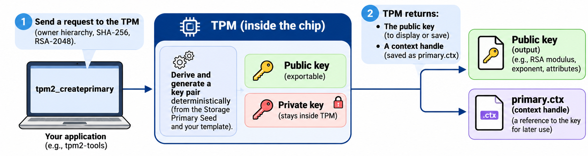
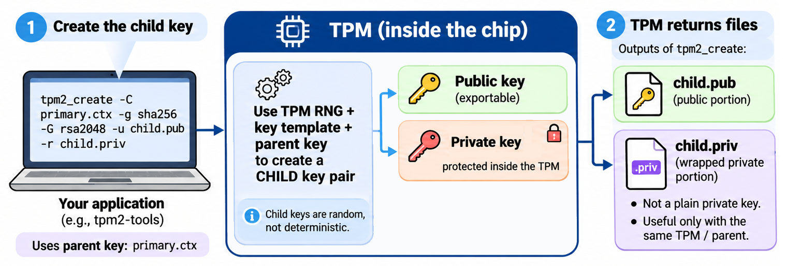

# TPM 2.0 Lab Exercises

This document contains progressive hands-on exercises for working with a TPM 2.0 — from basic discovery commands to sealing secrets and generating attestation quotes.

All exercises use the Linux `tpm2-tools` command-line utilities (see [TPM 2.0 Software Stack](03-TPM-software-stack.md)). Each lab builds on the previous one, and cross-references to the theory documents explain *why* each operation works the way it does.

> **Before you begin:** Make sure your TPM environment is set up and `tpm2-tools` is installed. See [TPM 2.0 Lab Setup](04-TPM-lab-setup.md) for environment choices, installation, and software TPM configuration.

| Lab | Topic           | Key concept demonstrated |
| --- | --------------- | ------------------------ |
| 1   | Discovery       | TPM capabilities, algorithms, PCR banks |
| 2   | PCR extend      | One-way accumulator, measurement order matters |
| 3   | Key hierarchies | Deterministic primary keys, hierarchy separation, key wrapping |
| 4   | Signing         | TPM-internal signing, tamper detection |
| 5   | Encryption      | Binding data to a specific TPM |
| 6   | Sealing         | PCR-based authorization policy, conditional secret release |
| 7   | Attestation     | Quote generation, nonce freshness, signature verification |
| 8   | NV storage      | Persistent data, monotonic counters |


## Lab 1: Discovery & Capabilities

This lab is read-only — it queries the TPM's [built-in capabilities](01-TPM-intro.md#what-a-tpm-provides) without changing any state.

### Query fixed properties

Fixed properties are set at manufacturing time and do not change:

```bash
tpm2_getcap properties-fixed
```

Look for:
- `TPM2_PT_FAMILY_INDICATOR` — should say "2.0"
- `TPM2_PT_MANUFACTURER` — the manufacturer code
- `TPM2_PT_FIRMWARE_VERSION_1` / `_2` — firmware version
- `TPM2_PT_NV_INDEX_MAX` — maximum size of a single NV index
- `TPM2_PT_HR_LOADED_MIN` — minimum number of objects the TPM can hold simultaneously

### Query variable properties

Variable properties reflect current TPM state:

```bash
tpm2_getcap properties-variable
```

Look for:
- `TPM2_PT_LOCKOUT_COUNTER` — current dictionary-attack lockout count (see [Dictionary-attack protection](01-TPM-intro.md#dictionary-attack-protection))
- `TPM2_PT_MAX_AUTH_FAIL` — maximum failed attempts before lockout

### Query supported algorithms

```bash
tpm2_getcap algorithms
```

The output lists every algorithm the TPM firmware supports. This is a much longer list than the handful of hardware engines described in [Coprocessors](01-TPM-intro.md#1-coprocessors-cryptographic-engines) — because a single hardware engine supports multiple algorithms and modes. For example, the RSA coprocessor implements `rsassa`, `rsapss`, `rsaes`, and `oaep`; the AES engine supports `ctr`, `cbc`, `cfb`, `ofb`, and `ecb` modes.

| Hardware engine | Algorithms reported by `tpm2_getcap` |
| --- | --- |
| SHA (hash) | `sha1`, `sha256`, `sha384`, `hmac`, `mgf1`, `keyedhash` |
| AES (symmetric) | `aes`, `ctr`, `ofb`, `cbc`, `cfb`, `ecb`, `xor`, `symcipher` |
| RSA (asymmetric) | `rsa`, `rsassa`, `rsapss`, `rsaes`, `oaep` |
| ECC (asymmetric) | `ecc`, `ecdsa`, `ecdaa`, `ecdh`, `ecschnorr` |
| Firmware (KDFs) | `kdf1_sp800_56a`, `kdf1_sp800_108` |

Not all of these are backed by dedicated hardware — many are firmware-driven modes on top of a hardware engine, and KDFs are firmware-only. See [Cryptographic algorithms](01-TPM-intro.md#2-cryptographic-algorithms) for the full breakdown.

The specific algorithms available depend on your TPM's manufacturer and firmware version. Compare your output against the algorithm-agile design described in [TPM Versions](01-TPM-intro.md#tpm-versions-12-vs-20).

### Query PCR banks

```bash
tpm2_getcap pcrs
```

Sample output:

```
selected-pcrs:
  - sha1: [ ]
  - sha256: [ 0, 1, 2, 3, 4, 5, 6, 7, 8, 9, 10, 11, 12, 13, 14, 15, 16, 17, 18, 19, 20, 21, 22, 23 ]
  - sha384: [ ]
```

This shows one line per PCR bank (one bank per hash algorithm). The numbers in brackets are the allocated PCR indices. In this example, only the **SHA-256 bank** has PCRs allocated (all 24, indices 0–23). The SHA-1 and SHA-384 banks exist as supported algorithms but have no PCRs assigned — meaning the firmware chose not to allocate them. This is common on modern TPMs that prioritize SHA-256.

For more on PCR banks and what gets measured into which register, see [Platform Configuration Registers](02-TPM-internals.md#platform-configuration-registers-pcrs).

### Generate random bytes

```bash
# 16 random bytes, displayed as hex
tpm2_getrandom --hex 16

# 32 random bytes, saved to a file
tpm2_getrandom -o random.bin 32
```

This uses the TPM's hardware random number generator — see [Random number generator](01-TPM-intro.md#2-random-number-generator-rng).


## Lab 2: Reading and Extending PCRs

This lab demonstrates the one-way accumulator property of [PCRs](02-TPM-internals.md#platform-configuration-registers-pcrs). We use **PCR 16**, which is the designated debug/test register that can be extended freely without affecting system operation.

### Read all PCR values

```bash
tpm2_pcrread sha256
```

On a software TPM (or after a fresh boot on hardware), most PCRs will be all zeros. On a hardware TPM after a measured boot, PCRs 0–7 will contain firmware and boot measurements. Here is sample output from a Proxmox server with a hardware TPM after a measured boot:

```
sha256:
  0 : 0x3CD59ACF...  ← firmware code measurement
  1 : 0x278E65F0...  ← firmware configuration
  2 : 0x3D458CFE...  ← external firmware / Option ROMs
  3 : 0x3D458CFE...  ← external firmware configuration
  4 : 0xD9713799...  ← boot manager code
  5 : 0xDE7A297E...  ← boot configuration / GPT
  6 : 0x3D458CFE...  ← host platform manufacturer
  7 : 0x5F1EDB8D...  ← Secure Boot policy
  8 : 0xB81ED41A...  ← OS measurements
  9 : 0x85D8CA89...  ← OS measurements
  10: 0x36E81E83...  ← OS measurements
  11: 0x00000000...  ← unused (all zeros)
  12: 0x00000000...  ← unused (all zeros)
  13: 0x00000000...  ← unused (all zeros)
  14: 0xA10F0A3E...  ← boot authority events
  15: 0x00000000...  ← unused (all zeros)
  16: 0x00000000...  ← debug/test (all zeros)
  17: 0xFFFFFFFF...  ← D-RTM (all ones — not used)
  18–22: 0xFFFFFFFF...  ← D-RTM (all ones — not used)
  23: 0x00000000...  ← application-specific (all zeros)
```

Three patterns are visible:

- **Non-zero values (PCRs 0–10, 14)** — these contain boot measurements extended by firmware and the OS during measured boot. The specific values change with any firmware or boot configuration change.
- **All zeros (PCRs 11–13, 15–16, 23)** — nothing was measured into these registers. PCR 16 is the debug/test register used in the labs below.
- **All ones / `0xFF` (PCRs 17–22)** — these are reserved for Dynamic Root of Trust for Measurement (D-RTM). Their `0xFF` initial value indicates D-RTM was not used on this boot — see the [initial values table](02-TPM-internals.md#platform-configuration-registers-pcrs).

Compare this with the [PCR assignment table](02-TPM-internals.md#what-gets-measured-into-which-pcr) to understand what each register records.

### Read a specific PCR

```bash
tpm2_pcrread sha256:16
```

PCR 16 should be all zeros (its initial value on `Startup(CLEAR)` — see the [initial values table](02-TPM-internals.md#platform-configuration-registers-pcrs)).

### Extend PCR 16 with a measurement

Compute the SHA-256 digest of the string "hello" and extend it into PCR 16:

```bash
DIGEST=$(echo -n "hello" | sha256sum | cut -d' ' -f1)
tpm2_pcrextend 16:sha256=$DIGEST
```

### Observe the result

```bash
tpm2_pcrread sha256:16
```

The value is no longer all zeros. It is `Hash(old_value || digest)` — the extend formula from [How extend works](02-TPM-internals.md#how-extend-works).

### Extend again with the same value

```bash
tpm2_pcrextend 16:sha256=$DIGEST
tpm2_pcrread sha256:16
```

The PCR value changed *again*, even though the input measurement was the same. This is because the old PCR value was different the second time — demonstrating that PCRs are a **one-way accumulator** that captures the complete, ordered history of measurements.

### Verify the math manually

You can confirm the extend formula yourself:

```bash
# Starting value: PCR 16 after the first extend
# PCR_new = SHA-256( PCR_old || measurement_digest )

# Step 1: Get PCR 16 initial value (32 zero bytes)
INITIAL="0000000000000000000000000000000000000000000000000000000000000000"

# Step 2: Compute first extend
MEASUREMENT=$(echo -n "hello" | sha256sum | cut -d' ' -f1)
FIRST_EXTEND=$(echo -n "${INITIAL}${MEASUREMENT}" | xxd -r -p | sha256sum | cut -d' ' -f1)
echo "Expected after first extend: ${FIRST_EXTEND}"

# Step 3: Compute second extend
SECOND_EXTEND=$(echo -n "${FIRST_EXTEND}${MEASUREMENT}" | xxd -r -p | sha256sum | cut -d' ' -f1)
echo "Expected after second extend: ${SECOND_EXTEND}"

# Step 4: Compare with actual PCR value
tpm2_pcrread sha256:16
```

The computed values should match what the TPM reports.


## Lab 3: Key Hierarchies & Primary Keys

This lab creates primary and child keys within the TPM's [key hierarchies](02-TPM-internals.md#key-hierarchies), demonstrating [deterministic derivation](02-TPM-internals.md#key-generation-and-derivation) and key wrapping.

Create a working directory to keep key files organized:

```bash
mkdir -p /tmp/tpmlab/keys && cd /tmp/tpmlab/keys
```

### Create a primary key under the Storage hierarchy

```bash
tpm2_createprimary -C o -g sha256 -G rsa2048 -c primary.ctx
```

| Flag             | Meaning |
| ---------------- | ------- |
| `-C o`           | Parent hierarchy: **o**wner (Storage hierarchy) — see [The three hierarchies](02-TPM-internals.md#the-three-hierarchies) |
| `-g sha256`      | Hash algorithm for the key's name computation |
| `-G rsa2048`     | Key algorithm: RSA-2048 |
| `-c primary.ctx` | Save the key's context (a handle for later use) to this file |

This command asks the TPM to generate an RSA-2048 **key pair** (a public key and a private key). The TPM derives both deterministically from the Storage Primary Seed and the template you specified — see [Key generation and derivation](02-TPM-internals.md#key-generation-and-derivation) for the full process.

The screen output shows the **public portion** only — the RSA modulus, exponent, attributes, and algorithms. The **private key stays inside the TPM** and is never exposed. The file `primary.ctx` is not the key itself — it is a context handle that lets you reference this key in later commands (e.g., as a parent when creating child keys). See [Key storage](02-TPM-internals.md#key-storage) for how transient, persistent, and external keys differ.



> The key is loaded into the TPM's **volatile RAM** — it will be lost on reboot or TPM reset. This is fine for a primary key because the derivation is deterministic: running the same command again regenerates the exact same key. If you need the key to survive reboots without regeneration, you can make it persistent in NV memory using `TPM2_EvictControl` (shown [later in this lab](#make-a-key-persistent-optional)).

### Inspect the primary key

```bash
tpm2_readpublic -c primary.ctx
```

This displays the key's public attributes — algorithm, key size, object attributes (such as `fixedTPM`, `fixedParent`, `sensitiveDataOrigin`), and the public key value.

### Verify deterministic derivation

Create the same primary key again with the same parameters:

```bash
tpm2_createprimary -C o -g sha256 -G rsa2048 -c primary2.ctx
tpm2_readpublic -c primary2.ctx
```

Compare the public key values — they should be **identical**. This demonstrates the deterministic derivation described in [Key generation and derivation](02-TPM-internals.md#key-generation-and-derivation): same hierarchy seed + same template = same key.

### Create a primary key under the Endorsement hierarchy

```bash
tpm2_createprimary -C e -g sha256 -G rsa2048 -c ek.ctx
tpm2_readpublic -c ek.ctx
```

The `-C e` flag targets the **e**ndorsement hierarchy. This key is derived from a different seed (the Endorsement Primary Seed), so its public key value will be entirely different from the Storage hierarchy primary key.

### Create child keys

Child keys use the TPM's random number generator — they are **not** deterministic:

```bash
# Create a child key pair under the storage primary
tpm2_create -C primary.ctx -g sha256 -G rsa2048 -u child.pub -r child.priv
```

The `-u` and `-r` flags save the public and private (wrapped) portions of the key to files. The private portion is encrypted by the parent key — this is the key wrapping described in [Key storage](02-TPM-internals.md#key-storage). The `child.priv` file is useless without access to the TPM that created it.



Both `child.pub` and `child.priv` are **binary files** — the TPM tools serialize (marshal) them in a raw TPM2B format so they can be loaded back with `tpm2_load`. If you `cat` them, you will see garbled characters. The human-readable output (algorithm, attributes, RSA modulus) is printed to the screen by `tpm2_create` at creation time. To inspect the key again later, load it and use `tpm2_readpublic`:

```bash
# Load the child key into the TPM
tpm2_load -C primary.ctx -u child.pub -r child.priv -c child.ctx

# Inspect it
tpm2_readpublic -c child.ctx
```

### Make a key persistent (optional)

Normally, keys are transient — they disappear when the TPM is reset or the context is flushed. To make a key survive across reboots:

```bash
# Assign the primary key to persistent handle 0x81000001
tpm2_evictcontrol -C o -c primary.ctx 0x81000001

# Now you can reference it by handle instead of context file
tpm2_readpublic -c 0x81000001
```

This uses `TPM2_EvictControl` as described in [Key generation and derivation](02-TPM-internals.md#key-generation-and-derivation). To remove it later:

```bash
tpm2_evictcontrol -C o -c 0x81000001
```


## Lab 4: Signing & Verification

This lab creates a signing key and uses the TPM's [cryptographic coprocessors](01-TPM-intro.md#1-coprocessors-cryptographic-engines) to sign and verify data. The private key never leaves the TPM.

```bash
cd /tmp/tpmlab/keys
```

### Create a signing key

```bash
tpm2_create -C primary.ctx -g sha256 -G rsa2048:rsassa -u sign.pub -r sign.priv
tpm2_load -C primary.ctx -u sign.pub -r sign.priv -c sign.ctx
```

The `rsa2048:rsassa` specifies an RSA-2048 key with the RSASSA-PKCS1-v1_5 signing scheme.

### Sign a message

```bash
echo "This document is authentic." > message.txt
tpm2_sign -c sign.ctx -g sha256 -o signature.bin message.txt
```

The TPM performs the signing operation internally — the host software sends the message, and the TPM returns the signature.

### Verify the signature

```bash
tpm2_verifysignature -c sign.ctx -g sha256 -s signature.bin -m message.txt
```

If verification succeeds, the tool exits silently (exit code 0). If the signature is invalid, it reports an error.

### Demonstrate tamper detection

```bash
echo "This document has been modified." > tampered.txt
tpm2_verifysignature -c sign.ctx -g sha256 -s signature.bin -m tampered.txt
```

This should fail — the signature was computed over the original message, not the tampered one. Expected output:

```
ERROR: Esys_VerifySignature(0x2DB) - tpm:parameter(2):the signature is not valid
ERROR: Verify signature failed!
ERROR: Unable to run tpm2_verifysignature
```

### Try ECC signing

```bash
tpm2_create -C primary.ctx -g sha256 -G ecc256:ecdsa -u ecc_sign.pub -r ecc_sign.priv
tpm2_load -C primary.ctx -u ecc_sign.pub -r ecc_sign.priv -c ecc_sign.ctx

tpm2_sign -c ecc_sign.ctx -g sha256 -o ecc_sig.bin message.txt
tpm2_verifysignature -c ecc_sign.ctx -g sha256 -s ecc_sig.bin -m message.txt
```

Compare the signature sizes — the ECC signature is significantly smaller than the RSA signature, illustrating the efficiency advantage described in [TPM Versions](01-TPM-intro.md#tpm-versions-12-vs-20).


## Lab 5: Encryption & Decryption

This lab demonstrates [binding](02-TPM-internals.md#binding) — encrypting data so that only this specific TPM can decrypt it.

```bash
cd /tmp/tpmlab/keys
```

### Create a decryption key

```bash
tpm2_create -C primary.ctx -g sha256 -G rsa2048 \
  -u decrypt.pub -r decrypt.priv \
  -a "fixedtpm|fixedparent|sensitivedataorigin|userwithauth|decrypt"

tpm2_load -C primary.ctx -u decrypt.pub -r decrypt.priv -c decrypt.ctx
```

The `-a` flag explicitly sets the object attributes. The key difference from the signing key: `decrypt` is set (instead of `sign`), indicating this key is used for decryption.

### Encrypt and decrypt

```bash
echo "confidential data" > plaintext.txt

# Encrypt with the public key (this can be done without the TPM)
tpm2_rsaencrypt -c decrypt.ctx -o encrypted.bin plaintext.txt

# Decrypt with the TPM (requires the TPM that holds the private key)
tpm2_rsadecrypt -c decrypt.ctx -o decrypted.txt encrypted.bin

cat decrypted.txt
```

The encrypted file `encrypted.bin` can be copied anywhere — to a USB drive, uploaded to the cloud, or emailed. It is useless without the TPM that holds the decryption key. This is exactly the binding concept from [Binding](02-TPM-internals.md#binding).


## Lab 6: Sealing & Unsealing

This is the most important lab. It ties together key hierarchies and PCR measurements — the core [sealing](02-TPM-internals.md#sealing-and-binding) mechanism behind full-disk encryption tools like BitLocker and Linux LUKS+TPM. It demonstrates [why PCR values matter](02-TPM-internals.md#why-pcrs-matter) for platform security.

```bash
mkdir -p /tmp/tpmlab/seal && cd /tmp/tpmlab/seal
```

### Step 1: Ensure a primary key exists

If you still have `primary.ctx` from Lab 3, copy it here. Otherwise, create a new one:

```bash
tpm2_createprimary -C o -g sha256 -G rsa2048 -c primary.ctx
```

### Step 2: Note the current PCR 16 value

```bash
tpm2_pcrread sha256:16
```

If you extended PCR 16 in Lab 2, it will have a non-zero value. For a clean experiment, you can restart the software TPM to reset all PCRs, or use the value as-is — the sealing policy will lock to whatever the current value is.

### Step 3: Create a PCR-based authorization policy

This policy says "only unseal if PCR 16 still has its current value":

```bash
# Start a trial session (for computing the policy digest, not enforcing it)
tpm2_startauthsession -S session.ctx

# Add a PCR condition: PCR 16 in the SHA-256 bank must match current value
tpm2_policypcr -S session.ctx -l sha256:16 -L pcr_policy.dat

# End the trial session
tpm2_flushcontext session.ctx
```

The file `pcr_policy.dat` now contains the policy digest — a hash that encodes "PCR 16 must equal X."

### Step 4: Seal a secret with that policy

```bash
echo -n "my-disk-encryption-key" | \
  tpm2_create -C primary.ctx -g sha256 \
    -u sealed.pub -r sealed.priv \
    -L pcr_policy.dat -i-
```

The `-L` flag attaches the PCR policy, and `-i-` reads the secret from stdin. The secret is now wrapped inside a TPM object that can only be unsealed when the policy is satisfied.

### Step 5: Unseal — should succeed

```bash
# Load the sealed object
tpm2_load -C primary.ctx -u sealed.pub -r sealed.priv -c sealed.ctx

# Start a real policy session (for enforcement)
tpm2_startauthsession -S session.ctx --policy-session

# Satisfy the PCR condition (TPM checks PCR 16 against the policy)
tpm2_policypcr -S session.ctx -l sha256:16

# Unseal the secret
tpm2_unseal -c sealed.ctx -p session:session.ctx

# Clean up the session
tpm2_flushcontext session.ctx
```

The output should be `my-disk-encryption-key`.

### Step 6: Change the PCR and try again — should fail

Simulate a boot change by extending PCR 16:

```bash
tpm2_pcrextend 16:sha256=$(echo -n "tampered-firmware" | sha256sum | cut -d' ' -f1)
```

Now attempt to unseal:

```bash
tpm2_startauthsession -S session.ctx --policy-session
tpm2_policypcr -S session.ctx -l sha256:16
tpm2_unseal -c sealed.ctx -p session:session.ctx
```

This should fail with an authorization error. The PCR value no longer matches what was recorded in the policy, so the TPM refuses to release the secret. This is exactly what happens when BitLocker detects a modified boot chain — the drive stays locked.

### What you just demonstrated

The sealing policy acts as a conditional lock: the TPM will only release the secret when the platform is in the expected state. If anything changes the PCR values — a firmware update, a different bootloader, or a rootkit — the condition fails and the secret remains protected.


## Lab 7: Attestation (Quote & Verify)

This lab walks through the [remote attestation](02-TPM-internals.md#remote-attestation) workflow: creating an Attestation Key, generating a signed quote over selected PCRs, and verifying it — the same process a remote server uses to check a device's boot integrity.

```bash
mkdir -p /tmp/tpmlab/attest && cd /tmp/tpmlab/attest
```

### Step 1: Create an Endorsement Key

```bash
tpm2_createek -c ek.ctx -G rsa2048
```

### Step 2: Create an Attestation Key

```bash
tpm2_createak -C ek.ctx -c ak.ctx -G rsa2048 -g sha256 -s rsassa
```

This creates an AK under the Endorsement hierarchy, linked to the EK — see [Key roles](02-TPM-internals.md#key-roles).

### Step 3: Generate a nonce

In a real attestation protocol, the verifier generates this nonce and sends it to the attestor. Here we simulate both sides:

```bash
openssl rand -hex 16 > nonce.txt
cat nonce.txt
```

### Step 4: Generate a quote

Ask the TPM to sign the current PCR values with the AK:

```bash
tpm2_quote -c ak.ctx \
  -l sha256:0,1,2,3,4,5,6,7,16 \
  -q $(cat nonce.txt) \
  -m quote_message.bin \
  -s quote_signature.bin \
  -o pcr_values.bin
```

| Flag | Purpose |
| --- | --- |
| `-l sha256:0,1,2,3,4,5,6,7,16` | Select which PCRs to include in the quote |
| `-q` | The nonce (for freshness) |
| `-m` | Output: the signed quote message (TPM-generated structure) |
| `-s` | Output: the signature over the quote message |
| `-o` | Output: the actual PCR values |

The TPM constructs a digest over the selected PCR values, combines it with the nonce, and signs the result with the AK — exactly as described in step 4 of the [Remote Attestation workflow](02-TPM-internals.md#remote-attestation).

### Step 5: Verify the quote

This is what the verifier does — check that the signature is valid and the nonce matches:

```bash
tpm2_checkquote \
  -u ak.pub \
  -m quote_message.bin \
  -s quote_signature.bin \
  -f pcr_values.bin \
  -q $(cat nonce.txt)
```

> **Note:** The `-u ak.pub` flag requires the AK's public key. Export it with `tpm2_readpublic -c ak.ctx -o ak.pub` if it was not saved during key creation. Some versions of `tpm2_createak` save it automatically.

If the quote is valid, the tool prints the PCR digest and exits with code 0.

### Step 6: Demonstrate replay protection

Try verifying with a different nonce:

```bash
tpm2_checkquote \
  -u ak.pub \
  -m quote_message.bin \
  -s quote_signature.bin \
  -f pcr_values.bin \
  -q "0000000000000000000000000000dead"
```

This should fail — the nonce embedded in the signed quote does not match, so the verifier knows the response is either replayed or tampered with.


## Lab 8: NV Storage & Monotonic Counters

This lab demonstrates the TPM's [persistent memory](01-TPM-intro.md#persistent-memory-solid-flash--rom) — NV storage for configuration data and [monotonic counters](01-TPM-intro.md#3-monotonic-counters) for anti-rollback protection.

```bash
cd /tmp/tpmlab
```

### Store and retrieve data in NV memory

```bash
# Define an NV index that can hold 32 bytes
tpm2_nvdefine 0x01000001 -C o -s 32 -a "ownerread|ownerwrite"

# Write data to it
echo -n "persistent-config-data-1234567!" | tpm2_nvwrite 0x01000001 -C o -i-

# Read it back
tpm2_nvread 0x01000001 -C o -s 32
```

This data persists across TPM resets (but not across `swtpm_setup --overwrite`).

### Work with a monotonic counter

```bash
# Define an NV index as a counter
tpm2_nvdefine 0x01000002 -C o -s 8 -a "ownerread|ownerwrite|nt=counter"

# Increment it
tpm2_nvincrement 0x01000002 -C o

# Read the counter value
tpm2_nvread 0x01000002 -C o -s 8 | xxd -p

# Increment again
tpm2_nvincrement 0x01000002 -C o
tpm2_nvread 0x01000002 -C o -s 8 | xxd -p
```

The counter only goes up. There is no command to decrement or reset it to a previous value — that is the entire point of a monotonic counter, as described in [Monotonic counters](01-TPM-intro.md#3-monotonic-counters).

### Clean up NV indices

```bash
tpm2_nvundefine 0x01000001 -C o
tpm2_nvundefine 0x01000002 -C o
```

---

[← Previous: TPM 2.0 Lab Setup](04-TPM-lab-setup.md)
